# SecLeaf Q4 CTF 2026 — Writeups

## Challenge 1 — Disguise of SecLeaf

## Challenge Details

| Field | Information |
| --- | --- |
| Competition | SecLeaf Q4 CTF 2026 |
| Challenge | Disguise of SecLeaf |
| Category | OSINT |
| Solver | LOH JUN SHENG |
| Points | Not provided |
| Flag format | `SecLeaf{}` |
| Status | Solved |

## Challenge Prompt

> You know you want me, you know you need me, Find me where I am a disguise of SecLeaf on Instagram.
>
> Flag format: `SecLeaf{}`

The challenge also supplied links to SecLeaf's public social-media accounts, including its official Instagram profile:

- Instagram: `https://www.instagram.com/secleafofficial/`
- LinkedIn: `https://www.linkedin.com/company/secleaf`
- YouTube: `https://www.youtube.com/@SecLeaf`

## Overview

This was an open-source intelligence challenge based on Instagram usernames and public comments. No vulnerability exploitation, authentication bypass, automated scanning, or private-account access was required.

The decisive phrase was:

> Find me where I am a disguise of SecLeaf on Instagram.

SecLeaf's official Instagram username is `@secleafofficial`, not simply `@secleaf`. The word "disguise" suggested that the answer might be associated with another account using SecLeaf's preferred or natural username. This led to an investigation of the exact Instagram handle `@secleaf`.

## Initial Observations

The supplied Instagram link opened the official account:

```text
@secleafofficial
```

The account name and profile description confirmed that it represented SecLeaf. However, the challenge did not ask us merely to inspect the official profile. It specifically referred to a place where something was a "disguise of SecLeaf."

The username was therefore the main clue:

```text
Organization: SecLeaf
Official Instagram handle: @secleafofficial
Natural matching handle: @secleaf
```

If the exact `@secleaf` username already belonged to another person, SecLeaf would have to operate under a modified handle such as `@secleafofficial`. This made `@secleaf` the strongest candidate for the disguised location described by the riddle.

## Enumeration and Analysis

### Step 1 — Inspect the official SecLeaf account

The official Instagram profile was opened from the link supplied with the challenge:

```text
https://www.instagram.com/secleafofficial/
```

The visible account information identified it as SecLeaf's cybersecurity-community profile. The important observation was that the organization used the extended username `secleafofficial` rather than the exact name `secleaf`.

### Step 2 — Interpret the word "disguise"

The phrase "a disguise of SecLeaf" was treated as a username-based clue. The official account's modified handle suggested that the exact handle might already be occupied.

The next step was therefore to replace the official username with the organization's exact name:

```text
secleafofficial  ->  secleaf
```

### Step 3 — Visit the exact `@secleaf` handle

The following public profile was opened:

```text
https://www.instagram.com/secleaf/
```

The profile was not the official cybersecurity-community account. It displayed:

```text
Username: secleaf
Display name: Broken Anna
Bio: I wish I have my Alice
Followers: 44
Following: 0
```

This result matched the riddle. The account used the exact SecLeaf name while presenting itself as an unrelated personal profile—effectively the "disguise" referenced by the challenge.

### Step 4 — Inspect the account's content

The `@secleaf` profile had only one visible post. The post was dated December 9, 2016 and was available at:

```text
https://www.instagram.com/secleaf/p/BNzU4gSDuLb/
```

Because there was only one post, it was the logical place to continue the investigation. The image itself did not visibly contain the flag, so the post caption and public comments were inspected.

### Step 5 — Review the public comments

A recent comment on the old post was made by the account `@satisfyingblends`. The comment contained a string in the required `SecLeaf{}` format:

```text
SecLeaf{w3_w4nt_th1s_4cc0unt}
```

The text matched the expected flag format exactly. Its meaning also confirmed the username interpretation:

```text
w3_w4nt_th1s_4cc0unt
-> "we want this account"
```

This indicated that SecLeaf wanted the exact `@secleaf` Instagram username but had to use `@secleafofficial` because the shorter handle belonged to the unrelated account.

## Key Insight

The challenge was solved by correlating three details:

1. The organization is named **SecLeaf**.
2. Its official Instagram handle is **`@secleafofficial`** rather than `@secleaf`.
3. The exact **`@secleaf`** handle belongs to a different profile with a single old post.

The word "disguise" pointed away from the obvious official account and toward the unrelated account occupying the exact username. The flag was then found in the comments on that account's only post.

## Flag Retrieval

The final navigation path was:

```text
Official SecLeaf Instagram
        |
        v
Notice the modified handle: @secleafofficial
        |
        v
Check the exact handle: @secleaf
        |
        v
Open its only post
        |
        v
Inspect the public comments
        |
        v
Recover the flag
```

### Proof

The screenshot below directly shows the public `@secleaf` post and the comment containing the flag:


Evidence boundary: this preserved screenshot proves the final flag-bearing comment and the `@secleaf` post context. The official `@secleafofficial` profile and the historical profile biography were navigational observations recorded during the challenge; separate profile screenshots were not preserved. This distinction avoids presenting an unarchived profile view as screenshot evidence.

## Final Flag

```text
SecLeaf{w3_w4nt_th1s_4cc0unt}
```

## Conclusion

This challenge required careful interpretation of the wording rather than advanced tooling. The provided official Instagram link established the modified username, while the phrase "disguise of SecLeaf" suggested checking the exact `@secleaf` handle. The unrelated account using that handle contained one public post, and a recent comment on the post revealed the flag.

The main OSINT lesson is to examine usernames, naming variations, old public content, and comment sections. In social-media investigations, a modified official handle can reveal that the organization's preferred username is already controlled by another account.

---

## Challenge 2 — Shadow Chronometry

### Challenge Details

| Field | Information |
| --- | --- |
| Competition | SecLeaf Q4 CTF 2026 |
| Challenge | Shadow Chronometry |
| Category | OSINT |
| Solver | LOH JUN SHENG |
| Points | Not provided |
| Supplied file | `shadow_chronometry.jpg` |
| Flag format | `SecLeaf{latitude,longitude}` |
| Precision | Four decimal places |
| Status | Solved |

### Challenge Prompt

> Find coords.
>
> Flag Format: `SecLeaf{latitude,longitude}` — 4 decimal pts.

### Overview

This challenge supplied a single photograph and required the latitude and longitude of the landmark shown in it. The photograph contains a tall stone obelisk in the middle of a very wide urban avenue. An Argentine flag is flying beside the monument, while the surrounding buildings and advertisements provide additional confirmation of the city.

The landmark is the **Obelisco de Buenos Aires**, located at Plaza de la República at the intersection of Avenida 9 de Julio and Avenida Corrientes in Buenos Aires, Argentina.

### Supplied Image


### Initial File Inspection

The image was first identified from the challenge folder:

```text
/home/jackson/Documents/SecLeaf Writeup/shadow_chronometry.jpg
```

Running `file` confirmed that it was a standard JPEG image:

```bash
file shadow_chronometry.jpg
```

Output:

```text
shadow_chronometry.jpg: JPEG image data, JFIF standard 1.01,
aspect ratio, density 1x1, segment length 16, baseline,
precision 8, 4320x3240, components 3
```

The file did not expose GPS coordinates through the basic JPEG information, so the location had to be identified visually and verified using a map source.

### Visual Analysis

Several details in the photograph identify the location:

1. **Central obelisk** — The main structure has the distinctive tall, narrow, four-sided form and pointed top of the Obelisco de Buenos Aires.
2. **Argentine flag** — The blue-white-blue national flag beside the monument confirms Argentina as the country.
3. **Extremely wide avenue** — The monument stands on Avenida 9 de Julio, one of the best-known defining features of central Buenos Aires.
4. **Dense city-centre architecture** — The rows of mid-rise and high-rise buildings match the central Buenos Aires streetscape.
5. **Nearby commercial signs** — Visible signs include `Itaú` and `PANAMERICANO`, which are consistent with the buildings surrounding the obelisk.

Together, these clues rule out a generic obelisk and identify the monument as:

```text
Obelisco de Buenos Aires
Avenida Corrientes and Avenida 9 de Julio
Buenos Aires, Argentina
```

### Coordinate Verification

The image was checked for embedded location data before relying on visual geolocation. It contains no EXIF segment and therefore no GPS fields. A reproducible verifier then records the image hash, the visual landmark identification, the OpenStreetMap/Nominatim result, and the required rounding:

```bash
python3 solve_shadow_chronometry.py shadow_chronometry.jpg
```

Actual output:

```text
[+] SHA256: 1949e22e80223ce2622f025f3a0f14591eb63ab45911da57d005015061d71e17
[+] JPEG EXIF segment present: False
[+] GPS metadata present: False
[+] Landmark identified visually: Obelisco de Buenos Aires, Argentina
[+] Geocoder: OpenStreetMap/Nominatim
[+] Result: Obelisco, Avenida Corrientes, Microcentro, San Nicolás,
    Buenos Aires, Comuna 1, Ciudad Autónoma de Buenos Aires, Argentina
[+] Coordinates: latitude=-34.6037093, longitude=-58.3816296
[+] Rounded to four decimals: -34.6037, -58.3816
[+] Flag: SecLeaf{-34.6037,-58.3816}
```

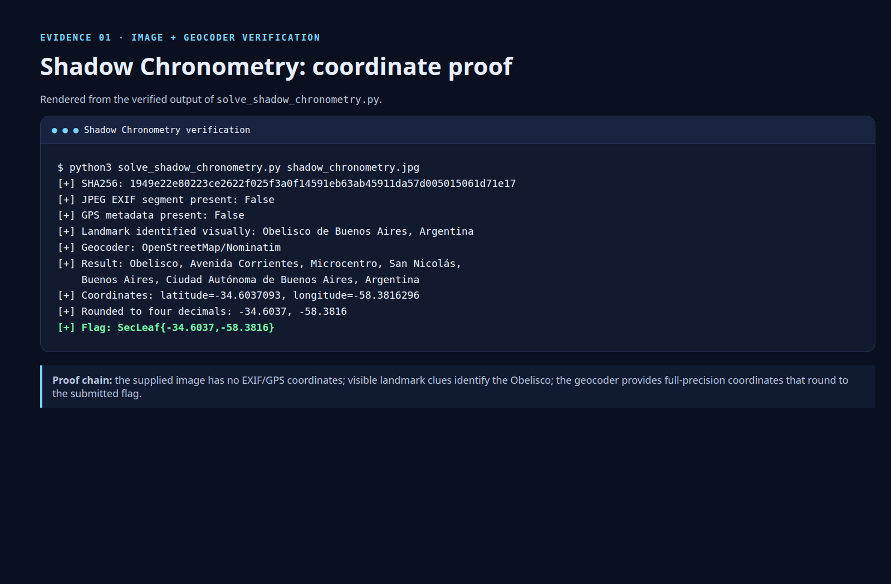

This proof separates the two reasoning stages: the monument is identified from visible image clues, then the coordinates are obtained from a named geocoder and rounded only at the final formatting step.

### Coordinate Formatting

The challenge required both values to be rounded to four decimal places:

```text
Latitude:  -34.6037093 -> -34.6037
Longitude: -58.3816296 -> -58.3816
```

The latitude and longitude were then placed into the required format without spaces:

```text
SecLeaf{latitude,longitude}
```

### Flag Retrieval

```text
Identifiable obelisk and Argentine flag
        |
        v
Recognize the Obelisco de Buenos Aires
        |
        v
Verify the landmark with map data
        |
        v
Obtain -34.6037093, -58.3816296
        |
        v
Round both coordinates to four decimal places
        |
        v
Construct the flag
```

### Evidence Files

| File | Purpose |
| --- | --- |
| `shadow_chronometry.jpg` | Original supplied landmark photograph |
| `solve_shadow_chronometry.py` | Reproducible EXIF-presence check, geocoder lookup, rounding, and flag construction |
| `assets/shadow-chronometry-solver-output.txt` | Plain-text successful verification output |
| `assets/shadow-chronometry-proof.png` | Readable rendered proof of the geocoding and rounding chain |

### Final Flag

```text
SecLeaf{-34.6037,-58.3816}
```

### Conclusion

The challenge was solved through visual geolocation. The Argentine flag established the country, while the unique shape of the monument, the wide avenue, the surrounding Buenos Aires skyline, and nearby commercial signage identified it as the Obelisco de Buenos Aires. Map data provided the precise coordinates, which were rounded to the required four decimal places before being inserted into the flag format.

The main OSINT lesson is to combine a landmark's shape with national symbols, road layout, surrounding architecture, and readable signs. A recognizable structure should still be verified against a reliable map source before its coordinates are submitted.

---

## Challenge 3 — Suspicious Activity

### Challenge Details

| Field | Information |
| --- | --- |
| Competition | SecLeaf Q4 CTF 2026 |
| Challenge | Suspicious Activity |
| Category | Network Forensics |
| Solver | LOH JUN SHENG |
| Points | Not provided |
| Supplied file | `suspicious_activity.pcap` |
| Flag format | `SecLeaf{}` |
| Status | Solved |

### Challenge Prompt

> Our SOC captured network activity from a workstation during a suspected security incident. Most of the traffic appears routine, but something does not belong.
>
> Analyze the capture, determine what occurred, and recover the flag.

The shortened prompt deliberately avoids naming the protocol, covert-channel technique, malicious domain, data encoding, or direction of transfer. Those details must be discovered from the packet capture itself.

### Overview

The supplied capture contains a mixture of ordinary DNS lookups and simulated HTTPS connections from several internal systems. Most DNS requests are for common domains such as `google.com`, `github.com`, `microsoft.com`, `ubuntu.com`, and `cloudflare.com`.

Four DNS requests from one internal host stand out. Their subdomain labels resemble encoded data and all terminate in the same unusual domain. Extracting the labels in packet order, concatenating them, and decoding the result reveals the flag.

### Initial File Inspection

The packet capture was identified with the `file` utility:

```bash
file suspicious_activity.pcap
```

Output:

```text
suspicious_activity.pcap: pcap capture file, microsecond ts
(little-endian) - version 2.4 (Ethernet, capture length 65535)
```

Capture information was then collected with `capinfos`:

```bash
capinfos suspicious_activity.pcap
```

Relevant output:

```text
Number of packets:     1,038
File size:             131 kB
Data size:             115 kB
Capture duration:      13.865012 seconds
Earliest packet time:  2026-10-06 02:41:33.594342
Latest packet time:    2026-10-06 02:41:47.459354
SHA256:                36de1b46547be01aa4e26666808987db595b1914a5723cf0612407701e98ce85
```

The capture is small enough for complete manual inspection, but it contains enough ordinary traffic to conceal a short sequence of anomalous packets.

### Traffic Analysis

The initial packet listing showed two dominant types of traffic:

1. DNS requests over UDP port 53.
2. Short TCP connections to port 443.

The DNS traffic was inspected with:

```bash
tcpdump -nn -r suspicious_activity.pcap 'udp port 53'
```

There were 39 DNS queries containing nine unique requested names. The common names and their query counts were:

```text
14  cloudflare.com
 9  microsoft.com
 6  github.com
 4  ubuntu.com
 2  google.com
```

These domains resemble normal browsing or background application traffic. Four additional queries were clearly different:

```text
U2VjTGVhZn.evil.com
tENDc0XzN4.evil.com
ZjFsX0RONX.evil.com
0=.evil.com
```

The unusual domain shared by all four requests was therefore:

```text
evil.com
```

### Wireshark Proof

The capture can also be verified visually in Wireshark. After opening `suspicious_activity.pcap`, the following display filter isolates only the suspicious DNS requests and removes their response packets:

```text
dns.flags.response == 0 && dns.qry.name contains "evil.com"
```

The resulting packet list contains exactly four requests. Wireshark shows the packet numbers, source host, destination resolver, DNS protocol, and complete query names in capture order:


The screenshot provides direct packet-level proof of the following observations:

```text
Packet 167  192.168.1.20 -> 8.8.8.8  U2VjTGVhZn.evil.com
Packet 293  192.168.1.20 -> 8.8.8.8  tENDc0XzN4.evil.com
Packet 395  192.168.1.20 -> 8.8.8.8  ZjFsX0RONX.evil.com
Packet 502  192.168.1.20 -> 8.8.8.8  0=.evil.com
```

To reproduce this view manually:

1. Start Wireshark.
2. Select **File > Open**.
3. Open `suspicious_activity.pcap`.
4. Paste the display filter into the green filter bar.
5. Press Enter to apply the filter.
6. Read the query names from top to bottom in packet-number order.

### Identifying the Compromised Host

The suspicious requests appeared in packets 167, 293, 395, and 502. All four had the same source and destination:

```text
Source:      192.168.1.20
Destination: 8.8.8.8
Protocol:    DNS over UDP port 53
Query type:  A
```

This identifies `192.168.1.20` as the workstation responsible for the suspicious DNS activity. The destination was a public DNS resolver, while the data itself was carried in subdomain labels under `evil.com`.

### Extracting the Payload

For each suspicious query, the final domain was removed and only the leading label was retained:

```text
Packet 167: U2VjTGVhZn
Packet 293: tENDc0XzN4
Packet 395: ZjFsX0RONX
Packet 502: 0=
```

Preserving packet order is important because each query carries only one fragment of the original payload. Concatenating the labels produces:

```text
U2VjTGVhZntENDc0XzN4ZjFsX0RONX0=
```

The characters and trailing `=` padding indicate Base64 encoding.

### Decoding the Data

The reconstructed string was decoded with:

```bash
printf '%s' 'U2VjTGVhZntENDc0XzN4ZjFsX0RONX0=' | base64 -d
```

Output:

```text
SecLeaf{D474_3xf1l_DN5}
```

The decoded value matches the required `SecLeaf{}` flag format.

### Automated and Reproducible Extraction

For independent verification, a standard-library Python extractor was saved beside the capture:

```text
extract_dns_payload.py
```

The script parses the classic PCAP structure, reads Ethernet, IPv4, UDP, and DNS headers, groups multi-label DNS requests by their parent domain, preserves packet order, joins the leading labels, tests the result as Base64, and reports a decoded SecLeaf payload.

It can be run from the writeup directory with:

```bash
python3 extract_dns_payload.py suspicious_activity.pcap
```

Actual output:

```text
[+] Capture: suspicious_activity.pcap
[+] DNS queries inspected: 39
[+] Suspicious domain: evil.com
[+] Ordered DNS fragments:
    packet 167: 192.168.1.20 -> 8.8.8.8  U2VjTGVhZn.evil.com  fragment=U2VjTGVhZn
    packet 293: 192.168.1.20 -> 8.8.8.8  tENDc0XzN4.evil.com  fragment=tENDc0XzN4
    packet 395: 192.168.1.20 -> 8.8.8.8  ZjFsX0RONX.evil.com  fragment=ZjFsX0RONX
    packet 502: 192.168.1.20 -> 8.8.8.8  0=.evil.com  fragment=0=
[+] Reconstructed Base64: U2VjTGVhZntENDc0XzN4ZjFsX0RONX0=
[+] Decoded payload: SecLeaf{D474_3xf1l_DN5}
```


The plain-text copy of this output is also retained at:

```text
assets/dns-extraction-output.txt
```

### Evidence Files

The complete supporting evidence for this challenge is stored in the same writeup folder:

| File | Purpose |
| --- | --- |
| `suspicious_activity.pcap` | Original packet capture |
| `extract_dns_payload.py` | Reproducible PCAP and DNS extraction script |
| `assets/wireshark-dns-proof.png` | Wireshark screenshot with the four filtered DNS requests |
| `assets/dns-payload-decode-proof.png` | Extraction, reconstruction, and decoding proof |
| `assets/dns-extraction-output.txt` | Plain-text output from the extractor |

This evidence chain allows the result to be checked visually in Wireshark, manually from the extracted labels, or automatically with the included Python script.

### Exfiltration Chain

```text
Inspect the packet-capture protocols
        |
        v
Enumerate the DNS query names
        |
        v
Identify four unusual requests to evil.com
        |
        v
Extract each leading subdomain label
        |
        v
Preserve packet order and concatenate the labels
        |
        v
Decode the reconstructed Base64 string
        |
        v
Recover the flag
```

### Key Findings

```text
Compromised host:  192.168.1.20
Malicious domain:  evil.com
Covert protocol:   DNS
Encoding:          Base64
Payload fragments: 4
```

### Final Flag

```text
SecLeaf{D474_3xf1l_DN5}
```

### Conclusion

The attacker hid a Base64-encoded payload inside a sequence of DNS subdomain queries. Because DNS requests are small and normally frequent, the four malicious packets could blend into routine name-resolution traffic. The anomalous domain and encoded-looking labels separated them from the surrounding requests.

The main network-forensics lesson is to inspect DNS query names rather than only counting requests or reviewing resolved IP addresses. Long, random-looking, or sequential subdomains can indicate DNS tunnelling or low-volume data exfiltration. The fragments must be sorted in capture order before decoding, because rearranging them would corrupt the reconstructed payload.

---

## Challenge 4 — Hensel Garden

### Challenge Details

| Field | Information |
| --- | --- |
| Competition | SecLeaf Q4 CTF 2026 |
| Challenge | Hensel Garden |
| Category | Cryptography / Mathematics |
| Solver | LOH JUN SHENG |
| Points | Not provided |
| Challenge folder | `Hensel_Garden/` |
| Supplied files | `chall.py`, `data.json` |
| Flag format | `SecLeaf{}` |
| Status | Solved |

### Challenge Prompt

> They say mathematics is all about finding your roots. Well, we planted a few, added some questionable soil, and now even the roots have trust issues.
>
> Go touch grass. Mathematically, of course.

The prompt hints at modular square roots and Hensel lifting without directly stating the equations or the prime-power moduli.

### Overview

The challenge generates a secret 128-bit seed and publishes two shifted square observations:

```text
(seed + 87)^2  mod 2^72
(seed + 143)^2 mod 3^51
```

The flag is encrypted with AES-GCM under a key derived from the unknown seed. Recovering the seed therefore requires solving both modular square-root equations, subtracting the public shifts, and combining the resulting congruences with the Chinese Remainder Theorem.

The moduli are coprime, and their product is larger than the entire 128-bit seed range. This makes the seed bound especially useful: after combining all possible root pairs, only one CRT result lies below `2^128`. The AES-GCM authentication tag then provides a final cryptographic verification.

### Supplied Files

The challenge folder contains:

```text
Hensel_Garden/
├── chall.py
└── data.json
```

File hashes:

```text
d8142a703ab1c3016ee4e350ddaf5858915ef9c4d217faa9bc693e7d51012d31  chall.py
e351235e1bfb32301cb4fe74f0ff16b16de906607491d214f1a2c2a4d570dc3d  data.json
```

### Reviewing the Construction

The relevant constants in `chall.py` are:

```python
SEED_BITS = 128
MODULI = (2**72, 3**51)
SHIFTS = (87, 143)
```

The public observations are produced by:

```python
def public_observations(seed):
    return [pow(seed + a, 2, m) for a, m in zip(SHIFTS, MODULI)]
```

The AES key is derived with:

```python
def derive_key(seed):
    return sha256(
        b'SecLeaf/hensel/v2/' + seed.to_bytes(16, 'big')
    ).digest()
```

Finally, the flag is encrypted using AES-GCM:

```python
AESGCM(key).encrypt(nonce, flag.encode(), None)
```

The encrypted field therefore contains the ciphertext followed by the 16-byte GCM authentication tag.

### Public Values

The released `data.json` provides:

```text
m1 = 4722366482869645213696 = 2^72
m2 = 2153693963075557766310747 = 3^51

a1 = 87
a2 = 143

y1 = 2090995815874869393993
y2 = 246419994095244398264902

nonce = 47058b956d0949a8d2e0c83d
```

The required equations are therefore:

```text
(seed + 87)^2  ≡ 2090995815874869393993   (mod 2^72)
(seed + 143)^2 ≡ 246419994095244398264902  (mod 3^51)
```

### Step 1 — Lift the Roots Modulo `2^72`

To solve a square congruence modulo a prime power, begin with roots modulo the prime and lift them one power at a time. If `r` is a root modulo `p^k`, every possible lift modulo `p^(k+1)` has the form:

```text
r + t*p^k, where t is one of 0, 1, ..., p-1
```

Each candidate is tested against the square congruence modulo the next prime power. This direct lifting method also handles the singular behaviour that can occur for powers of two, where the usual derivative-based shortcut may not be invertible.

Lifting the first observation through all 72 powers produces four square roots:

```text
311693314961566273123
2049489926473256333725
2672876556396388879971
4410673167908078940573
```

These are roots for `seed + 87`. Subtracting the shift modulo `2^72` gives four possible seed residues:

```text
seed ≡ 311693314961566273036   (mod 2^72)
seed ≡ 2049489926473256333638  (mod 2^72)
seed ≡ 2672876556396388879884  (mod 2^72)
seed ≡ 4410673167908078940486  (mod 2^72)
```

### Step 2 — Lift the Roots Modulo `3^51`

The same process is applied to the second observation, beginning modulo 3 and lifting through 51 powers. It produces two square roots:

```text
143629324417692064196608
2010064638657865702114139
```

Subtracting the shift of 143 gives:

```text
seed ≡ 143629324417692064196465   (mod 3^51)
seed ≡ 2010064638657865702113996  (mod 3^51)
```

### Step 3 — Combine the Residues with CRT

There are four possibilities from the first modulus and two from the second, producing eight root pairs:

```text
4 * 2 = 8 CRT combinations
```

For one residue `r1 mod m1` and one residue `r2 mod m2`, the combined solution can be computed as:

```text
seed = r1 + m1 * (((r2 - r1) * inverse(m1, m2)) mod m2)
```

The result is interpreted modulo:

```text
M = 2^72 * 3^51
  = 10170532185586709275835288996259756004356390912
```

This combined modulus is larger than `2^128`:

```text
M > 2^128
```

Consequently, each CRT combination can contribute at most one value inside the allowed 128-bit seed interval. Of the eight combinations, only one result satisfies the seed bound:

```text
seed = 282779946134366997745983790016833981964
```

In hexadecimal, the recovered 16-byte seed is:

```text
d4bd6fc49311dd10e59d1a891c1b0e0c
```

### Step 4 — Verify the Recovered Seed

The candidate was substituted into both original observations:

```text
pow(seed + 87,  2, 2^72) == 2090995815874869393993
pow(seed + 143, 2, 3^51) == 246419994095244398264902
```

Both comparisons returned `True`. This confirms that the seed satisfies all public mathematical constraints before any decryption is attempted.

### Step 5 — Derive the Key and Decrypt

The key is reconstructed exactly as in the challenge:

```text
SHA256("SecLeaf/hensel/v2/" || seed_as_16_big_endian_bytes)
```

The nonce is read from `data.json`, and the final 16 bytes of the encrypted blob are treated as the AES-GCM authentication tag. Decryption succeeds and the authentication tag verifies, proving that the correct seed and key were recovered.

The plaintext is:

```text
SecLeaf{r00ts_gr0w_through_pr1me_p0w3rs}
```

### Reproducible Solver

A complete solver was saved in the challenge folder:

```text
Hensel_Garden/solve_hensel_garden.py
```

The solver uses explicit prime-power lifting instead of relying on a modular-root function. It then performs CRT reconstruction, verifies the public observations, derives the SHA-256 key, and authenticates the AES-GCM ciphertext.

Run it with:

```bash
cd Hensel_Garden
python3 solve_hensel_garden.py data.json
```

Relevant output:

```text
[+] Observation 1: modulus = 2^72
    square roots (4): [...]
    seed residues (4): [...]
[+] Observation 2: modulus = 3^51
    square roots (2): [...]
    seed residues (2): [...]
[+] CRT combinations: 8
[+] Combined modulus exceeds 2^128: True
[+] In-range CRT candidates tested: 1
[+] Recovered seed: 282779946134366997745983790016833981964
[+] Seed hex: d4bd6fc49311dd10e59d1a891c1b0e0c
[+] Public observation checks: [True, True]
[+] AES-GCM authentication: valid
[+] Flag: SecLeaf{r00ts_gr0w_through_pr1me_p0w3rs}
```

### Solver Proof

The following proof image was generated from the actual solver output and includes the equations, lifted-root counts, CRT result, recovered seed, public-observation checks, authenticated decryption, and final flag:


### Solving Chain

```text
Read chall.py and data.json
        |
        v
Recognize two shifted square congruences
        |
        v
Lift roots modulo 2^72 and 3^51
        |
        v
Subtract the public shifts
        |
        v
Combine all eight residue pairs with CRT
        |
        v
Apply the 128-bit seed bound
        |
        v
Verify both public observations
        |
        v
Derive the SHA-256 key
        |
        v
Authenticate and decrypt the AES-GCM ciphertext
        |
        v
Recover the flag
```

### Evidence Files

| File | Purpose |
| --- | --- |
| `Hensel_Garden/chall.py` | Public challenge construction |
| `Hensel_Garden/data.json` | Public modular observations and encrypted flag |
| `Hensel_Garden/solve_hensel_garden.py` | Reproducible root-lifting, CRT, and decryption solver |
| `Hensel_Garden/assets/solver-output.txt` | Plain-text output from the successful solver run |
| `Hensel_Garden/assets/solver-proof.png` | Visual proof of seed and flag recovery |

### Key Findings

```text
First modulus:       2^72
Second modulus:      3^51
First root count:    4
Second root count:   2
CRT combinations:    8
In-range candidates: 1
Recovered seed:      282779946134366997745983790016833981964
Authenticated:       Yes
```

### Final Flag

```text
SecLeaf{r00ts_gr0w_through_pr1me_p0w3rs}
```

### Conclusion

The challenge is solvable because squaring modulo known prime powers does not hide the shifted seed irreversibly. Hensel lifting recovers every possible square root for each observation, and the Chinese Remainder Theorem combines the corresponding seed residues. The published 128-bit seed bound eliminates every CRT result except one.

The AES-GCM tag is important evidence rather than merely an encryption detail. A wrong seed produces a wrong SHA-256 key and fails authentication, while the recovered seed both reproduces the public observations and decrypts the ciphertext with a valid tag. These independent checks confirm the final flag.

---

## Challenge 5 — Nonce Nursery

### Challenge Details

| Field | Information |
| --- | --- |
| Competition | SecLeaf Q4 CTF 2026 |
| Challenge | Nonce Nursery |
| Category | Cryptography |
| Solver | LOH JUN SHENG |
| Points | Not provided |
| Challenge folder | `Nonce_Nursery/` |
| Supplied files | `chall.py`, `data.json` |
| Curve | secp256k1 |
| Flag format | `SecLeaf{}` |
| Status | Solved |

### Challenge Prompt

> Eleven signatures. Eleven different nonces. Surely nothing could go wrong, right?
>
> The developer said the nonce generator was perfectly secure. The developer also uses `random` for passwords.

The prompt emphasizes that the nonces are different, but uniqueness alone is insufficient for ECDSA. Nonces must also be unpredictable and unrelated. A deterministic relationship among distinct nonces can expose the private signing key.

### Overview

The challenge provides eleven chronological ECDSA signatures. The public generator reveals that one hidden consecutive interval of five nonces follows an affine recurrence:

```text
k[i+1] = A*k[i] + B  (mod n)
```

The remaining nonces are independent. The starting index, multiplier `A`, increment `B`, every nonce, and the private key are unknown.

The attack rewrites every ECDSA nonce as a linear expression in the private scalar. Within each possible five-signature window, the affine recurrence creates two quadratic equations in that scalar. Eliminating the quadratic term produces a private-key candidate, which can then be checked against the recurrence, public key, all signatures, and AES-GCM authentication tag.

### Supplied Files

```text
Nonce_Nursery/
├── chall.py
└── data.json
```

File hashes:

```text
7924ef537dc3d3f802f1ef42f8f7319013eec64c59ba1170b2458027d46db145  chall.py
cfbe739962f53caf3ed4e3cbc54432342058e312d929317ad89301a175c73705  data.json
```

### Reviewing the Vulnerability

The challenge uses the secp256k1 signing-group order:

```python
N = 0xFFFFFFFFFFFFFFFFFFFFFFFFFFFFFFFEBAAEDCE6AF48A03BBFD25E8CD0364141
```

The hidden nonce generator creates one consecutive length-five affine sequence:

```python
for j in range(start, start + 5):
    if j != start:
        k = (A*k + B) % N
    nonces[j] = k
```

The ECDSA signature equation is:

```text
s = k^-1 * (h + r*d) mod n
```

where:

```text
h = SHA256(message) interpreted as an integer modulo n
k = per-signature nonce
d = private signing scalar
(r, s) = signature
```

The flag-encryption key is derived from the private scalar:

```python
SHA256(
    b"SecLeaf/nonce-nursery/v2/" +
    private_scalar.to_bytes(32, "big")
)
```

The resulting key encrypts the flag with AES-GCM.

### Why Different Nonces Are Still Vulnerable

Rearranging the ECDSA equation gives the nonce directly as a linear function of the private scalar:

```text
k_i = s_i^-1 * (h_i + r_i*d) mod n
```

Define the public coefficients:

```text
alpha_i = r_i * s_i^-1 mod n
beta_i  = h_i * s_i^-1 mod n
```

Then every nonce can be written as:

```text
k_i = alpha_i*d + beta_i mod n
```

The nonces do not need to repeat. Once several of these linear expressions are known to follow the same recurrence, the shared private scalar can be solved algebraically.

### Step 1 — Convert Each Signature into a Nonce Form

For all eleven records, the solver computes:

```text
h_i     = SHA256(message_i) mod n
alpha_i = r_i / s_i mod n
beta_i  = h_i / s_i mod n
```

Division here means multiplication by the modular inverse. Each unknown nonce is represented as the linear polynomial:

```text
k_i(d) = alpha_i*d + beta_i
```

### Step 2 — Remove the Unknown Increment

For a candidate window of five signatures, define four consecutive nonce differences:

```text
Delta_0 = k_1 - k_0
Delta_1 = k_2 - k_1
Delta_2 = k_3 - k_2
Delta_3 = k_4 - k_3
```

If the nonces follow:

```text
k[i+1] = A*k[i] + B
```

then the additive constant disappears when differences are taken:

```text
Delta[i+1] = A*Delta[i]
```

The unknown multiplier can also be eliminated without dividing by a possibly zero difference:

```text
Delta_1^2 = Delta_0*Delta_2
Delta_2^2 = Delta_1*Delta_3
```

Because every `Delta_i` is linear in `d`, each relation becomes a quadratic polynomial in the private scalar.

### Step 3 — Eliminate the Quadratic Term

Let the two recurrence equations become:

```text
F(d) = f2*d^2 + f1*d + f0 = 0
G(d) = g2*d^2 + g1*d + g0 = 0
```

Multiplying `F` by `g2`, multiplying `G` by `f2`, and subtracting removes `d^2`:

```text
(g2*f1 - f2*g1)*d + (g2*f0 - f2*g0) = 0 mod n
```

When the linear coefficient is invertible, the private-key candidate is:

```text
d = -(g2*f0 - f2*g0) * inverse(g2*f1 - f2*g1, n) mod n
```

This calculation is repeated for every possible consecutive length-five interval.

### Step 4 — Locate the Vulnerable Window

Eleven signatures contain seven possible length-five windows:

```text
00-04
01-05
02-06
03-07
04-08
05-09
06-10
```

The solver evaluates each candidate against both polynomial equations, reconstructs the affine recurrence, and compares the derived public key with the supplied secp256k1 public key.

The decisive results were:

```text
window 00-04: polynomials=False recurrence=False public_key=False
window 01-05: polynomials=False recurrence=False public_key=False
window 02-06: polynomials=False recurrence=False public_key=False
window 03-07: polynomials=True  recurrence=True  public_key=True
window 04-08: polynomials=False recurrence=False public_key=False
window 05-09: polynomials=False recurrence=False public_key=False
window 06-10: polynomials=False recurrence=False public_key=False
Valid affine windows: 1
```

The hidden affine sequence is therefore:

```text
records 03, 04, 05, 06, and 07
```

### Step 5 — Recover the Private Scalar

The valid window produces the private signing scalar:

```text
d = 112265246509443991793501805575047025825485946730594207565612276875367956223710
```

Its 32-byte hexadecimal representation is:

```text
f833e0b49cd9652c84292c5097b7dbdfd4005fdd2d1cfa7c975cce14a34616de
```

Computing `d*G` on secp256k1 reproduces the supplied public key exactly:

```text
x = e2561c6009d76b813e9f7d68b52afd6367acb47b52b698167c7e51730b3d5470
y = dcaa09bb36c8aaf9ef80837103fce068379efa76ac1fef125accfca737c007b6
```

### Step 6 — Reconstruct the Affine Sequence

With `d` known, the five vulnerable nonces are:

```text
k[03] = 41304517631639763765528057784181352511284851208342180032850117440010981400792
k[04] = 94616110354051687246924639039205831752405185240859828276834923572596808652416
k[05] = 113134321544840914306842848178060935542394930476825490867707908649977356178624
k[06] = 84469879293713744081190541239943336594490140363391225771979851936725341976607
k[07] = 28095761905820652288737236573093097102643639695001890321799422277589200472134
```

The affine parameters are:

```text
A = 12002070106840870913456878479932247169232302458330232490370288228710231070153
B = 185253452489428381004099908606325852331606826069828067596639196212430708489
```

Every adjacent nonce in the vulnerable window satisfies:

```text
k[i+1] = A*k[i] + B mod n
```

### Step 7 — Verify All Signatures

The recovered private scalar allows every nonce to be reconstructed from its signature:

```text
k_i = s_i^-1 * (h_i + r_i*d) mod n
```

For each of the eleven records, the solver then computes the elliptic-curve point `k_i*G` and checks:

```text
x(k_i*G) mod n == r_i
```

All eleven checks returned `True`. This verifies the recovered private scalar against every signature, including the six signatures whose nonces were independently generated.

### Step 8 — Derive the AES Key and Decrypt

The recovered scalar is serialized as exactly 32 big-endian bytes and appended to the challenge's fixed key-derivation prefix:

```text
key = SHA256(
    "SecLeaf/nonce-nursery/v2/" || d.to_bytes(32, "big")
)
```

The released AES-GCM nonce is:

```text
293913b75cab1570ef4929fb
```

The final 16 bytes of the encrypted blob are used as the GCM authentication tag. Decryption succeeds and the tag validates, producing:

```text
SecLeaf{4ff1n3_n0nc3s_b3nd_th3_curv3}
```

### Reproducible Solver

The complete solver is stored at:

```text
Nonce_Nursery/solve_nonce_nursery.py
```

Run it with:

```bash
cd Nonce_Nursery
python3 solve_nonce_nursery.py data.json
```

Relevant output:

```text
[+] Curve: secp256k1
[+] Signatures: 11
[+] Testing every consecutive length-5 window
    window 00-04: polynomials=False recurrence=False public_key=False
    window 01-05: polynomials=False recurrence=False public_key=False
    window 02-06: polynomials=False recurrence=False public_key=False
    window 03-07: polynomials=True recurrence=True public_key=True
    window 04-08: polynomials=False recurrence=False public_key=False
    window 05-09: polynomials=False recurrence=False public_key=False
    window 06-10: polynomials=False recurrence=False public_key=False
[+] Valid affine windows: 1
[+] Vulnerable window: 03-07
[+] Private scalar: 112265246509443991793501805575047025825485946730594207565612276875367956223710
[+] Private scalar hex: f833e0b49cd9652c84292c5097b7dbdfd4005fdd2d1cfa7c975cce14a34616de
[+] Public-key check: True
[+] All 11 nonce/r checks: True
[+] AES-GCM authentication: valid
[+] Flag: SecLeaf{4ff1n3_n0nc3s_b3nd_th3_curv3}
```

### Solver Proof

The proof image below was rendered from the verified solver output. It records the affine equations, tested window, recovered private scalar, recurrence validation, public-key match, all-signature verification, authenticated decryption, and final flag:

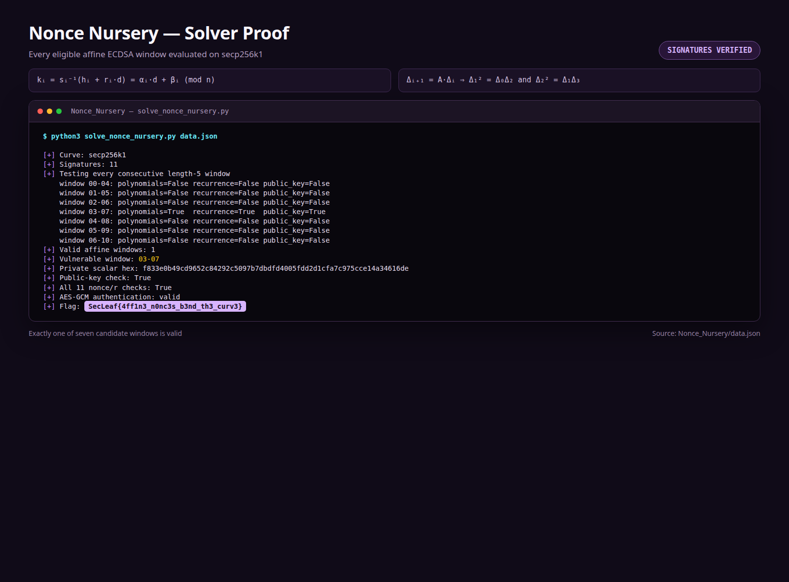

### Solving Chain

```text
Read the eleven chronological signatures
        |
        v
Express every nonce as alpha*d + beta
        |
        v
Test each consecutive five-signature window
        |
        v
Use nonce differences to remove B
        |
        v
Build two quadratic equations in d
        |
        v
Eliminate d^2 and recover a candidate scalar
        |
        v
Find the valid window at records 03-07
        |
        v
Verify d*G against the supplied public key
        |
        v
Verify all eleven nonce/r relationships
        |
        v
Derive the AES key and authenticate the ciphertext
        |
        v
Recover the flag
```

### Evidence Files

| File | Purpose |
| --- | --- |
| `Nonce_Nursery/chall.py` | Public vulnerable nonce-generation model |
| `Nonce_Nursery/data.json` | Eleven signatures, public key, and encrypted flag |
| `Nonce_Nursery/solve_nonce_nursery.py` | Reproducible private-key recovery and decryption solver |
| `Nonce_Nursery/assets/solver-output.txt` | Full output from the successful solver run |
| `Nonce_Nursery/assets/solver-proof.png` | Visual proof of the recovered key and flag |

### Key Findings

```text
Curve:                  secp256k1
Signatures:             11
Vulnerable window:      03-07
Nonce relationship:     k[i+1] = A*k[i] + B mod n
Recovered private key:  f833e0b49cd9652c84292c5097b7dbdfd4005fdd2d1cfa7c975cce14a34616de
Public-key match:       Yes
All signature checks:   Passed
AES-GCM authentication: Valid
```

### Final Flag

```text
SecLeaf{4ff1n3_n0nc3s_b3nd_th3_curv3}
```

### Conclusion

The challenge demonstrates that ECDSA requires more than merely avoiding exact nonce reuse. Each nonce in the vulnerable interval was different, but the affine relation among five consecutive values leaked enough structure to recover the private key.

Once each nonce was expressed as a linear function of the same private scalar, the recurrence supplied polynomial constraints that could be solved without guessing the nonces, `A`, or `B`. The recovered scalar matched the public key, reproduced the `r` value of every signature, and authenticated the encrypted flag. These checks provide independent confirmation that the recovery is correct.

---

## Challenge 6 — AFSK Broadcast

### Challenge Details

| Field | Information |
| --- | --- |
| Competition | SecLeaf Q4 CTF 2026 |
| Challenge | AFSK Broadcast |
| Category | Forensics / Signal Analysis |
| Solver | LOH JUN SHENG |
| Points | Not provided |
| Supplied file | `signal.wav` |
| Modulation | Bell 202 AFSK |
| Symbol rate | 1200 baud |
| Flag format | `SecLeaf{}` |
| Status | Solved |

### Challenge Prompt

> Our ground station picked up a brief, unauthorized broadcast over an amateur radio band late last night. To the untrained ear, it just sounds like harsh static and beeps, but our SIGINT team believes it is a localized off-grid data burst.
>
> We suspect the sender is using an older audio frequency-shift keying protocol transmitting at 1200 baud. We isolated the transmission into the attached audio file. Filter out the noise, demodulate the signal, and retrieve the secret message.

### Overview

The supplied WAV contains approximately 30 seconds of low-level noise followed by a very short, high-energy data burst. The burst uses Bell 202 audio frequency-shift keying:

```text
1200 Hz = mark  = logical 1
2200 Hz = space = logical 0
1200 symbols per second
```

After isolating the final 0.178322 seconds, each symbol was classified by comparing its phase-independent correlation energy at 1200 Hz and 2200 Hz. The recovered bitstream contained 21 valid asynchronous serial frames using 8N1 framing with the data bits transmitted least-significant bit first.

### Initial File Inspection

The file was identified with:

```bash
file signal.wav
```

Output:

```text
signal.wav: RIFF (little-endian) data, WAVE audio,
Microsoft PCM, 16 bit, mono 44100 Hz
```

`ffprobe` provided the remaining properties:

```text
Codec:           PCM signed 16-bit little-endian
Sample rate:     44100 Hz
Channels:        1
Duration:        30.178322 seconds
File size:       2661772 bytes
Bit rate:        approximately 705.6 kb/s
```

The SHA-256 hash of the supplied recording is:

```text
c5533052cc63b7e2ce9878cc269816e5990442afc3c4b56d89f4800a5093e6fe  signal.wav
```

### Step 1 — Locate the Burst

The audio was divided into 10-millisecond blocks, and the root-mean-square amplitude of each block was measured. The median background level was:

```text
Estimated noise RMS: 882.95
```

A detection threshold five times above that level was used:

```text
Burst threshold: 4414.74
```

The first block above the threshold began at exactly 30 seconds:

```text
Burst start:    30.000000 seconds
Burst samples:  7864
Burst duration: 0.178322 seconds
```

This explains why a full-file spectrogram makes the transmission difficult to see: the useful signal occupies less than two-tenths of a second at the very end of a 30-second recording.

### Step 2 — Crop and Filter the Audio

The burst was isolated and band-limited to the expected AFSK region:

```bash
ffmpeg -ss 30 -i signal.wav \
  -af "highpass=f=800,lowpass=f=2600,volume=0.35" \
  -c:a pcm_s16le assets/signal-cleaned.wav
```

The high-pass filter removes low-frequency interference, while the low-pass filter suppresses content above the two Bell 202 tones.

The following annotated spectrogram shows the isolated and filtered burst between 800 Hz and 2600 Hz. The overlay marks the two Bell 202 frequencies used by the demodulator:

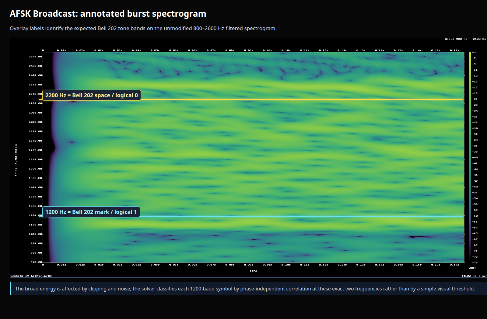

The strongest useful regions are concentrated around the lower mark band and upper space band. The source is heavily saturated, so the tones spread into nearby frequencies; the coloured guides identify the exact frequencies tested by the solver rather than claiming that the plot alone cleanly separates every symbol.

### Step 3 — Establish Symbol Timing

At 1200 baud and a sample rate of 44100 Hz, each symbol occupies:

```text
44100 / 1200 = 36.75 samples per symbol
```

The 7864-sample burst therefore contains approximately:

```text
7864 / 36.75 ≈ 214 symbols
```

Because the symbol length is fractional, boundaries were calculated with rounded floating-point positions rather than assuming a fixed integer number of samples per symbol:

```text
start_j = round(j * 36.75)
end_j   = round((j + 1) * 36.75)
```

This alternates between 36-sample and 37-sample windows while maintaining timing across the complete burst.

### Step 4 — Discriminate the Two Tones

For every symbol window, the solver measures the complex correlation energy at both Bell 202 frequencies. For frequency `f`, the phase-independent energy is:

```text
E(f) = |sum((x[n] - mean(x)) * exp(-j*2*pi*f*n/Fs))|^2
```

The decision rule is:

```text
if E(1200 Hz) >= E(2200 Hz): bit = 1
else:                        bit = 0
```

This method is more reliable than checking individual sample signs or zero crossings because it works regardless of the tone's starting phase.

The demodulator recovered:

```text
Symbols:             214
Mean tone confidence: 0.9226
```

The high confidence confirms that the two tone states remain distinguishable despite the clipping and background noise.

### Step 5 — Identify the Serial Framing

The direct tone bits did not form aligned ASCII bytes when grouped into arbitrary blocks of eight. The stream was therefore tested as asynchronous serial data with standard 8N1 framing:

```text
1 start bit: 0
8 data bits: least-significant bit first
No parity
1 stop bit: 1
```

Every possible bit offset within a ten-bit UART frame was tested. Offset 2 produced:

```text
Best UART bit offset:      2
Valid frames:              21/21
Printable/control bytes:   21/21
```

Two synchronization bits occur before the first frame, and two remain after the final frame.

For example, the first recovered frame is:

```text
0 11001010 1
^ ^^^^^^^^ ^
| data     stop
start
```

Reading the eight data bits least-significant bit first gives:

```text
0x53 = "S"
```

The complete 21-frame bit map is shown below. Cyan cells are 1200 Hz logical ones, and purple cells are 2200 Hz logical zeroes:

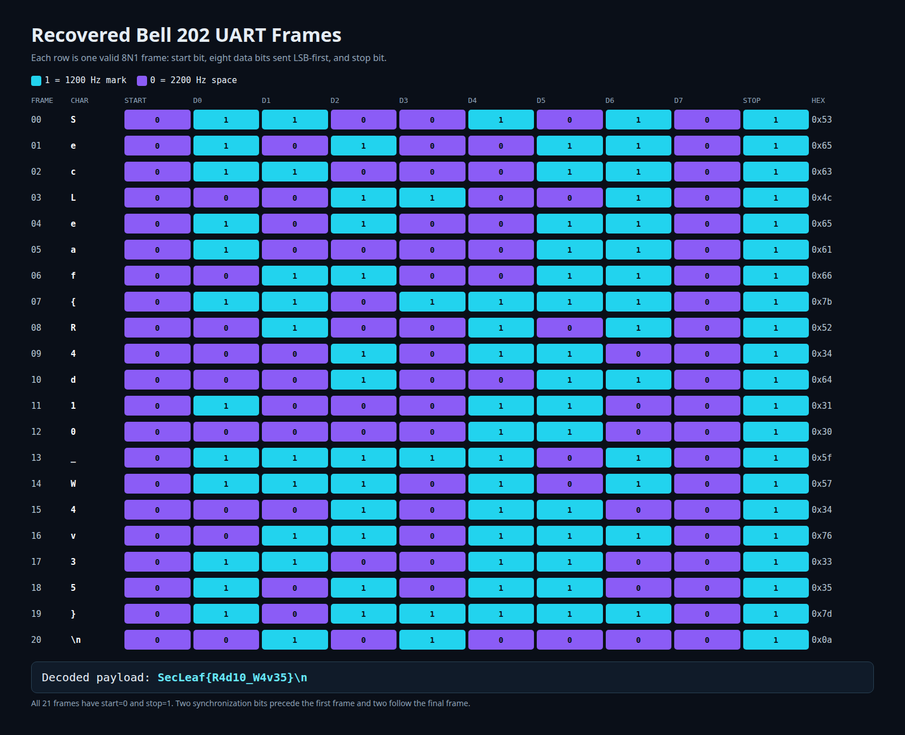

### Step 6 — Reconstruct the Message

The recovered bytes in hexadecimal are:

```text
53 65 63 4c 65 61 66 7b 52 34 64 31 30 5f 57 34 76 33 35 7d 0a
```

Converting the bytes to ASCII produces:

```text
SecLeaf{R4d10_W4v35}\n
```

The final byte `0a` is a newline terminator. Removing it leaves the flag:

```text
SecLeaf{R4d10_W4v35}
```

### Reproducible Demodulator

A dependency-free Python demodulator was saved beside the recording:

```text
solve_signal_afsk.py
```

It uses only Python's standard library to:

1. Read the 16-bit PCM WAV.
2. Estimate the background-noise level.
3. Locate the high-energy burst.
4. Split it into 1200-baud symbol windows.
5. Compare 1200 Hz and 2200 Hz correlation energy.
6. Search UART frame offsets.
7. Decode valid 8N1 frames.
8. Print the recovered message.

Run it with:

```bash
python3 solve_signal_afsk.py signal.wav
```

Actual output:

```text
[+] Format: PCM 16-bit mono at 44100 Hz
[+] Total duration: 30.178322 s
[+] Estimated noise RMS: 882.95
[+] Burst start: 30.000000 s
[+] Burst samples: 7864
[+] Burst duration: 0.178322 s
[+] Modulation: Bell 202 AFSK, 1200 baud
[+] Mark/1: 1200 Hz; Space/0: 2200 Hz
[+] Samples per symbol: 36.7500
[+] Symbols recovered: 214
[+] Mean tone confidence: 0.9226
[+] UART format: 8N1, LSB first
[+] Best UART bit offset: 2
[+] Valid UART frames: 21/21
[+] Payload hex: 5365634c6561667b52346431305f57347633357d0a
[+] Payload repr: 'SecLeaf{R4d10_W4v35}\n'
[+] Secret message: SecLeaf{R4d10_W4v35}
```

### Solver Proof

The following proof image was generated from the verified demodulator output. It records the burst timing, Bell 202 frequencies, symbol count, tone confidence, UART alignment, decoded hexadecimal bytes, and final flag:

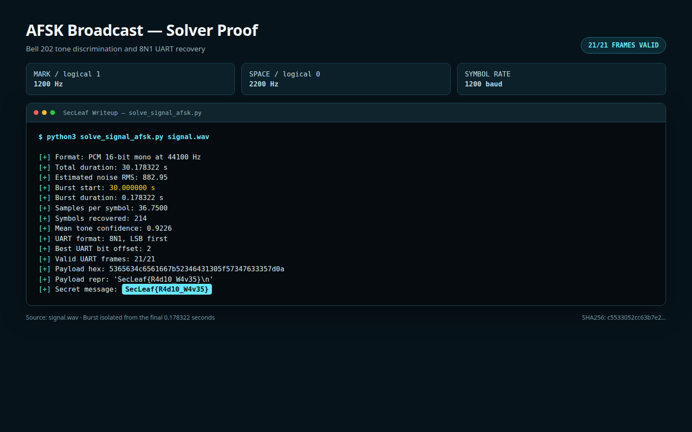

### Solving Chain

```text
Inspect signal.wav
        |
        v
Measure block RMS across the recording
        |
        v
Locate the burst at 30.000000 seconds
        |
        v
Crop and band-pass the final 0.178322 seconds
        |
        v
Split the burst into 1200-baud symbols
        |
        v
Compare 1200 Hz and 2200 Hz correlation energy
        |
        v
Recover 214 logical bits
        |
        v
Find 8N1 UART alignment at bit offset 2
        |
        v
Decode 21 valid LSB-first frames
        |
        v
Recover the secret message
```

### Evidence Files

| File | Purpose |
| --- | --- |
| `signal.wav` | Original noisy audio recording |
| `solve_signal_afsk.py` | Reproducible Bell 202 and UART demodulator |
| `assets/signal-cleaned.wav` | Cropped and band-limited data burst |
| `assets/signal-afsk-burst.png` | Unannotated spectrogram generated from the isolated AFSK burst |
| `assets/signal-afsk-annotated.html` | Source page that overlays the two tested Bell 202 frequencies |
| `assets/signal-afsk-annotated.png` | Annotated spectrogram showing the 1200 Hz and 2200 Hz guides |
| `assets/signal-uart-frames.png` | Visual map of all 21 decoded UART frames |
| `assets/signal-solver-output.txt` | Plain-text demodulator output |
| `assets/signal-solver-proof.png` | Visual proof of message and flag recovery |

### Key Findings

```text
Sample rate:          44100 Hz
Burst start:          30.000000 seconds
Burst duration:       0.178322 seconds
Modulation:           Bell 202 AFSK
Mark frequency:       1200 Hz
Space frequency:      2200 Hz
Symbol rate:          1200 baud
Serial format:        8N1, LSB first
Symbols recovered:    214
Valid UART frames:    21/21
Mean tone confidence: 0.9226
```

### Final Flag

```text
SecLeaf{R4d10_W4v35}
```

### Conclusion

The recording concealed a short Bell 202 transmission after a much longer period of background noise. Isolating the final 0.178322 seconds made the signal manageable, while phase-independent tone correlation reliably separated the 1200 Hz mark and 2200 Hz space frequencies.

The demodulated bits were not an AX.25 packet or raw byte-aligned data. They formed ordinary 8N1 asynchronous serial frames with least-significant-bit-first data. All 21 frames had valid start and stop bits, and their payload decoded directly to the SecLeaf flag followed by a newline.

---

## Challenge 7 — Sugar Glass

### Challenge Details

| Field | Information |
| --- | --- |
| Competition | SecLeaf Q4 CTF 2026 |
| Challenge | Sugar Glass |
| Category | Reverse Engineering |
| Solver | LOH JUN SHENG |
| Points | Not provided |
| Supplied file | `sugar_glass` |
| Flag format | `SecLeaf{}` |
| Status | Solved |

### Challenge Prompt

> It's glass. How hard could it possibly be to break?
>
> Famous last words, probably.

### Overview

`sugar_glass` is a stripped 64-bit PIE ELF executable. It accepts either a command-line argument or one line from standard input, then passes the candidate through a custom verifier. The accepted input is not stored as a plaintext string. Instead, the verifier reads 29 expected bytes from `.rodata`, visits input positions in a permuted order, mixes each input byte into a rolling state, and compares the low byte of a calculated accumulator with a second table.

The byte transformation can be reversed one position at a time. For every verifier round, exactly one candidate from the 256 possible byte values produces the required target byte. Reassembling these uniquely recovered bytes in their original positions gives the flag.

### Initial File Inspection

The supplied artifact was identified and hashed before analysis:

```bash
file sugar_glass
sha256sum sugar_glass
strings -a -n 4 sugar_glass
```

Relevant output:

```text
sugar_glass: ELF 64-bit LSB pie executable, x86-64, version 1 (SYSV),
dynamically linked, interpreter /lib64/ld-linux-x86-64.so.2, stripped

25c9c5aa2b4cbae288e55cbdd31f24656ffaa4931c3d9f217bcc44d127501a0d  sugar_glass

Filed.
Rejected.
SGR2
```

The binary is stripped, so the function names are unavailable. However, the import table still shows the important input-handling routines:

```text
fgets
strncpy
strlen
strcspn
puts
```

The two output strings, `Filed.` and `Rejected.`, establish the success and failure paths. The `SGR2` marker identifies a likely custom verifier-data structure.

### Step 1 — Locate the Input and Success Check

Disassembling the executable shows that the program accepts an argument when one is supplied; otherwise, it reads a line from standard input. It removes the trailing line ending with `strcspn`, obtains the candidate length with `strlen`, and passes the string and its length to an internal verifier at file virtual address `0x1230`.

```bash
objdump -d -M intel sugar_glass
```

The caller checks the verifier result and prints `Filed.` only when it returns true. The verifier first enforces the expected input length:

```text
movzx  ebp,BYTE PTR [rip+0xde4]     # first SGR2 parameter
cmp    rbp,rsi                      # strlen(candidate)
jne    failure
```

The first verifier parameter is `0x1d`, so the accepted input must contain exactly 29 characters.

### Step 2 — Read the Verifier Tables

The `.rodata` section contains the following data beginning at offset `0x2020`:

```text
53 47 52 32 1d 0b 05 42
```

Interpreted as an `SGR2` header, this means:

```text
Magic:          SGR2
Required length: 29
Index step:     11
Initial index:  5
Initial state:  0x42
```

The next 29 bytes are the round table, followed by 29 target bytes:

```text
Round table:
e5 5f b1 5d df ad 9b b9 6e 3f 15 f1 43 dc 40 a5 cd d3 d9 6b 04 21 48 46 52

a4 89 b1 cb

Target bytes:
7b 7d 34 f7 74 78 b2 56 83 11 29 cb e1 a6 35 40 e5 91 50 29 30 48 47 24 b9

5d 8b 19 b2
```

The line break is only for readability: each table contains 29 bytes.

### Step 3 — Understand the Byte Permutation

The verifier does not process the candidate from left to right. It starts at input index 5 and adds 11 modulo 29 after every round:

```text
5, 16, 27, 9, 20, 2, 13, 24, 6, 17, 28, 10, 21, 3, 14,
25, 7, 18, 0, 11, 22, 4, 15, 26, 8, 19, 1, 12, 23
```

Because 11 and 29 are coprime, this sequence reaches each of the 29 input positions exactly once. The output order can therefore be reconstructed without guessing any characters.

For each round, the verifier:

1. XORs the current input byte with one byte from the round table.
2. Adds a rolling state and rotates its low byte left by three bits.
3. XORs the state with a round constant starting at `0x39` and increasing by `0x11` per round.
4. Rotates the resulting low byte left by one bit and adds it to an accumulator initialized to `0x5d`.
5. Compares the accumulator's low byte with the corresponding target-table byte.

Only the low byte is checked at the final comparison. Testing all 256 possible values for the current input position produces exactly one valid candidate at every round.

### Step 4 — Recover the Input

A dependency-free solver was saved beside the challenge binary:

```text
solve_sugar_glass.py
```

It finds the `SGR2` marker, parses the four-byte header and the two 29-byte tables, models the verifier's rotations and rolling state, then tests all byte values at every round. The unique byte candidate is placed at the corresponding permuted input position.

Run it with:

```bash
python3 solve_sugar_glass.py sugar_glass
```

Actual output:

```text
[+] Binary: sugar_glass
[+] SGR2 table offset: 0x2020
[+] Parameters: length=29, step=11, initial_index=5, initial_state=0x42
[+] Unique byte candidates recovered: 29/29
[+] Accepted input: SecLeaf{gl455_h0ld5_4_53cr3t}
```

The exact output is retained in:

```text
assets/sugar-glass-solver-output.txt
```

### Step 5 — Verify Against the Original Binary

The original supplied file did not have the execute permission set. A disposable copy was given execute permission outside the challenge folder, then run with the recovered string as its only argument:

```bash
cp sugar_glass /home/jackson/.hermes/cache/scratch/sugar_glass.verify
chmod 700 /home/jackson/.hermes/cache/scratch/sugar_glass.verify
/home/jackson/.hermes/cache/scratch/sugar_glass.verify \
  'SecLeaf{gl455_h0ld5_4_53cr3t}'
```

Actual output:

```text
Filed.
```

This is the binary's success message, confirming that the reconstructed 29-byte input passes the original verifier.

### Visual Verifier Proof

The following rendered evidence image preserves the verifier marker, the successful solver output, and the `Filed.` result from an executable copy of the original supplied binary:

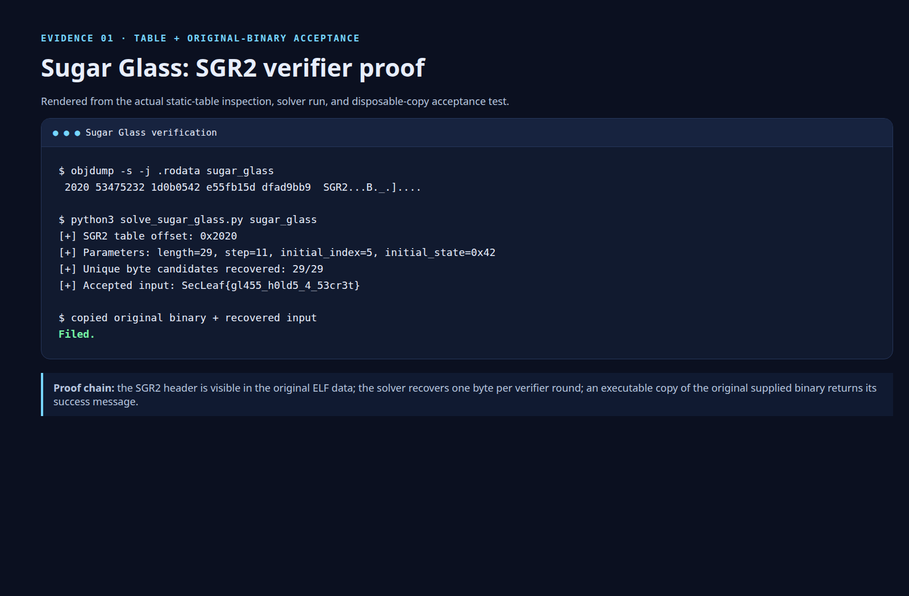

### Solving Chain

```text
Inspect the stripped ELF binary
        |
        v
Find the success/failure strings and SGR2 data marker
        |
        v
Disassemble the internal verifier at 0x1230
        |
        v
Parse the length, permutation, round table, and target table
        |
        v
Model the per-byte rolling-state transformation
        |
        v
Test 0x00 through 0xff for each verifier round
        |
        v
Reassemble the uniquely recovered input bytes
        |
        v
Run the original binary with the recovered candidate
        |
        v
Receive the success message: Filed.
```

### Evidence Files

| File | Purpose |
| --- | --- |
| `sugar_glass` | Original supplied ELF executable |
| `solve_sugar_glass.py` | Reproducible solver for the `SGR2` verifier |
| `assets/sugar-glass-solver-output.txt` | Actual solver output and binary acceptance result |
| `assets/sugar-glass-proof.html` | Source page for the rendered verifier-proof image |
| `assets/sugar-glass-proof.png` | Visual proof of SGR2 data, unique recovery, and `Filed.` acceptance |

### Key Findings

```text
Binary type:             64-bit stripped PIE ELF
Required input length:   29 bytes
Verifier marker:         SGR2
Verifier table offset:   0x2020
Initial input index:     5
Index step:              11 modulo 29
Recovered byte rounds:   29/29 unique candidates
Verification result:     Filed.
```

### Final Flag

```text
SecLeaf{gl455_h0ld5_4_53cr3t}
```

### Conclusion

Sugar Glass uses a custom rolling byte verifier rather than a direct string comparison. The program attempts to obscure the expected input by permuting the input positions, mixing each byte with a stateful sequence, and retaining only a target-byte table. This construction is reversible because each round has a known state and a one-byte unknown; exhaustive testing of the 256 possible values yields one valid byte per round.

The main reverse-engineering lesson is that stripped binaries still reveal their logic through imports, string references, data sections, and machine instructions. A custom verifier should be translated into a small, exact model, then validated by running the untouched challenge binary with the recovered input.

---

## Challenge 8 — Dead Letter Office

### Challenge Details

| Field | Information |
| --- | --- |
| Competition | SecLeaf Q4 CTF 2026 |
| Challenge | Dead Letter Office |
| Category | Reverse Engineering |
| Solver | LOH JUN SHENG |
| Points | Not provided |
| Challenge folder | `Dead Letter Office/` |
| Supplied files | `dead_letter_office`, `postcard.grid` |
| Flag format | `SecLeaf{}` |
| Status | Solved |

### Challenge Prompt

> I sent a very important letter. It never arrived. Typical.
>
> Anyways, you're the post office now. Go find it. No refunds btw.

### Overview

This challenge consists of a stripped ELF verifier and a binary companion file named `postcard.grid`. The executable reads `postcard.grid` from its working directory before accepting an argument or one line of standard input. The candidate must pass both the postcard's integrity checks and a stateful two-character verifier.

The postcard does not contain the accepted string in plaintext. It stores 20 selected 16-bit target words among 80 bytes of payload. The binary uses a decoded eight-byte key, a changing 16-bit state, rotations, and 14 inner rounds to check two candidate characters at a time. Since the state and target word for each outer round are known, all 65,536 possible two-byte values can be tested. Every round has exactly one valid pair, which reconstructs the full 40-character flag.

### Initial File Inspection

The challenge folder contains:

```text
Dead Letter Office/
├── dead_letter_office
└── postcard.grid
```

The supplied files were identified and hashed:

```bash
file postcard.grid dead_letter_office
sha256sum postcard.grid dead_letter_office
```

Output:

```text
postcard.grid:      data
dead_letter_office: ELF 64-bit LSB pie executable, x86-64, version 1 (SYSV),
dynamically linked, interpreter /lib64/ld-linux-x86-64.so.2, stripped

c8e6202b861df51c9be991633a48b35d97770b843206914bb6587eed3feed0fd  postcard.grid
2c906e0628ff8830573bc0101e74aa23e7ecc4b2c90d649586e751f133ed4cb9  dead_letter_office
```

String inspection exposes the user-facing outcomes and the expected companion filename:

```text
Delivered.
Returned to sender.
postcard.grid
No mail.
DLO2
```

### Step 1 — Understand the Postcard Container

A hex dump of `postcard.grid` begins with:

```text
48 50 4c 32 28 00 14 00 ec d9 cb 41 c6 39 00 00
```

The executable treats the first 16 bytes as an `HPL2` header:

```text
Magic:                 HPL2
Required input length: 40 bytes
Character-pair count:  20
Payload FNV-1a hash:   0x41cbd9ec
Initial 16-bit state:  0x39c6
```

The full file is 208 bytes long. The verifier requires this exact layout:

```text
0x80-byte header/reserved area
+ 20 records × 4 bytes each
= 208 bytes
```

It then computes 32-bit FNV-1a over the 80-byte payload at offset `0x80` and compares the result with the header value. The calculated integrity value is:

```text
0x41cbd9ec
```

This matches the postcard header, so the target data has not been altered.

### Step 2 — Locate and Decode the Verifier Constants

The main function opens `postcard.grid` in binary mode, checks the `HPL2` magic, validates the candidate length and pair count, verifies the exact file size, and then performs the FNV-1a check.

The executable's `.rodata` section contains a second marker:

```text
DLO2
```

at offset `0x2060`. Eight following bytes are decoded using:

```text
key[i] = encoded[i] XOR ((31*i - 0x5b) mod 256)
```

The recovered eight-byte key is:

```text
20 2f 57 4d bc 50 10 a4
```

The next constants specify the verifier schedule:

```text
Initial target selector: 7
Selector increment:      7
Inner rounds per pair:   14
```

There are 20 character pairs. Adding 7 modulo 20 produces the target-record order:

```text
7, 14, 1, 8, 15, 2, 9, 16, 3, 10,
17, 4, 11, 18, 5, 12, 19, 6, 13, 0
```

For each selector, the verifier reads a 16-bit target word from the first two bytes of the corresponding four-byte record. The second word in each record is not used by the acceptance check.

### Step 3 — Model the Pair Verifier

The program processes the candidate in 20 consecutive two-character pairs. For each outer round, it:

1. XORs the first character with the current 16-bit state and the second character with that state's high byte.
2. Runs 14 rounds of additions, rotations, XOR operations, and accesses to the decoded eight-byte key.
3. Rotates and mixes the previous 16-bit state with an outer-round constant.
4. Compares the resulting low bytes against the selected target word.
5. Sets the selected target word as the state for the next pair.

The verifier combines every pair's mismatch result with a bitwise OR. Therefore, a candidate is accepted only when every one of the 20 pair checks evaluates to zero.

The important practical property is that a round depends on only two unknown bytes. With the target word, previous state, outer-round index, and key known, testing all `256 × 256 = 65,536` pairs reveals a unique result for each round.

### Step 4 — Recover the Letter

A dependency-free solver was saved in the challenge folder:

```text
Dead Letter Office/solve_dead_letter_office.py
```

The solver:

1. Parses and validates the `HPL2` postcard header.
2. Recomputes FNV-1a over the payload.
3. Locates and decodes the `DLO2` verifier constants in the executable.
4. Recreates the target-selector sequence.
5. Models the 14-round two-byte verifier exactly.
6. Brute-forces all 65,536 byte pairs for every outer round.
7. Requires exactly one matching pair in all 20 rounds.

Run it from the challenge folder:

```bash
cd 'Dead Letter Office'
python3 solve_dead_letter_office.py postcard.grid dead_letter_office
```

Actual output:

```text
[+] Grid: postcard.grid
[+] DLO2 constants offset: 0x2060
[+] Header: length=40, pairs=20, seed=0x39c6
[+] FNV-1a check: 0x41cbd9ec (valid)
[+] Inner verifier rounds: 14
[+] Unique character pairs recovered: 20/20
[+] Accepted input: SecLeaf{th3_p0st0ff1c3_h4s_4_d4rk_s1d3!}
```

The complete output, including final binary validation, is retained at:

```text
Dead Letter Office/assets/solver-output.txt
```

### Step 5 — Verify Against the Original Binary

The supplied executable did not have execute permission. A disposable copy was created outside the challenge folder together with its required `postcard.grid` companion file, then run from that copy directory with the reconstructed input:

```bash
work=$(mktemp -d)
cp dead_letter_office postcard.grid "$work"
chmod 700 "$work/dead_letter_office"
(cd "$work" && ./dead_letter_office \
  'SecLeaf{th3_p0st0ff1c3_h4s_4_d4rk_s1d3!}')
```

Actual output:

```text
Delivered.
```

`Delivered.` is the binary's success condition, confirming that the recovered 40-character input passes both the postcard validation and all 20 two-character verifier rounds.

### Visual Verifier Proof

The following rendered evidence image shows the `HPL2` postcard header, the `DLO2` marker in the ELF, the full pair-recovery result, and the original program's `Delivered.` acceptance result:

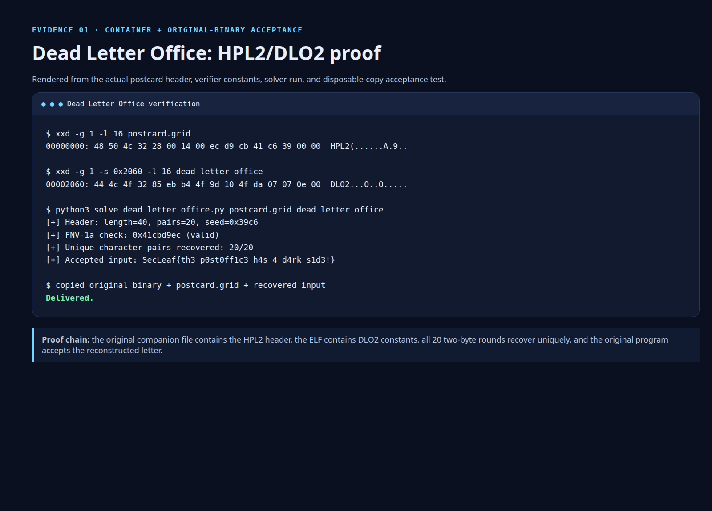

### Solving Chain

```text
Inspect the ELF and postcard.grid
        |
        v
Find HPL2 and DLO2 data markers
        |
        v
Parse the postcard header and verify its FNV-1a payload hash
        |
        v
Disassemble the verifier and decode its key material
        |
        v
Derive the 20-record target selector order
        |
        v
Model the 14-round verifier for one character pair
        |
        v
Brute-force 65,536 pairs for each of 20 rounds
        |
        v
Join the 20 unique pairs into the accepted letter
        |
        v
Run the original verifier and receive Delivered.
```

### Evidence Files

| File | Purpose |
| --- | --- |
| `Dead Letter Office/dead_letter_office` | Original ELF verifier |
| `Dead Letter Office/postcard.grid` | Original `HPL2` target and integrity container |
| `Dead Letter Office/solve_dead_letter_office.py` | Reproducible postcard parser and pair-recovery solver |
| `Dead Letter Office/assets/solver-output.txt` | Actual solver output and original-binary acceptance proof |
| `Dead Letter Office/assets/solver-proof.html` | Source page for the rendered verifier-proof image |
| `Dead Letter Office/assets/solver-proof.png` | Visual proof of the HPL2/DLO2 data and `Delivered.` acceptance |

### Key Findings

```text
Verifier container:          HPL2
Required input length:       40 bytes
Input pairs:                 20
Verifier marker:             DLO2
DLO2 constants offset:       0x2060
Postcard payload hash:       FNV-1a 0x41cbd9ec
Inner rounds per pair:       14
Unique recovered pairs:      20/20
Original binary result:      Delivered.
```

### Final Flag

```text
SecLeaf{th3_p0st0ff1c3_h4s_4_d4rk_s1d3!}
```

### Conclusion

Dead Letter Office combines a validated binary data container with a custom stateful verifier. The `HPL2` postcard format ensures that the 80-byte target payload is intact, while the `DLO2` logic obscures the required input by checking it as 20 independent-but-state-linked two-byte rounds.

The construction is still reversible because every round has a known target and state, leaving only two unknown bytes. Enumerating the 65,536 possible pairs is small enough to be exhaustive, and the binary's `Delivered.` response independently verifies the reconstructed letter.

---

## Challenge 9 — Reflected Storm

### Challenge Details

| Field | Information |
| --- | --- |
| Competition | SecLeaf Q4 CTF 2026 |
| Challenge | Reflected Storm |
| Category | Network Forensics |
| Solver | LOH JUN SHENG |
| Points | Not provided |
| Supplied file | `Reflected Storm/reflected-storm.pcap` |
| Flag format | `FLOWTRIQ{<victim_ip>_<count>_reflectors}` |
| Status | Solved |

### Challenge Prompt

> A network operator noticed their monitoring dashboard lighting up. Bandwidth on one server spiked without explanation, and by the time they pulled a packet capture, the attack was already underway. Your job: open the capture, identify the victim being hammered by amplified traffic, and figure out how many reflectors the attacker abused to do it.
>
> Flag format: `FLOWTRIQ{<victim_ip>__reflectors}`
>
> Example: `FLOWTRIQ{192.168.1.1_3_reflectors}`

The concrete example establishes the required final separator placement: one underscore before the reflector count, followed by `_reflectors`.

### Overview

The capture contains a DNS amplification attack. A threat actor sent DNS `ANY` queries to several open resolvers while spoofing the victim's source address. The resolvers returned much larger TXT responses to the spoofed address, causing amplified traffic to converge on the victim.

The victim was identified from the destination of the large UDP/53 responses. The reflector count was determined by enumerating the distinct DNS-server source IPs sending those amplified responses.

### Initial File Inspection

The supplied artifact was identified, hashed, and profiled before traffic analysis:

```bash
file reflected-storm.pcap
sha256sum reflected-storm.pcap
capinfos reflected-storm.pcap
```

Relevant output:

```text
reflected-storm.pcap: pcap capture file, microsecond ts (little-endian)
- version 2.4 (Raw IPv4, capture length 65535)

d84c61ae868e58c79455bb6f3a8ff20b0217e32f76e2ca15ffded0dd2d3c055b  reflected-storm.pcap

Number of packets:   1,340
File size:           685 kB
Data size:           664 kB
Capture duration:    88.271141 seconds
Earliest packet time: 2024-10-31 22:00:01.744317
Latest packet time:   2024-10-31 22:01:30.015458
Encapsulation:       Raw IPv4
```

The use of Raw IPv4 means each packet begins directly with an IPv4 header; there is no Ethernet header to skip before parsing the IP and UDP fields.

### Step 1 — Identify the Amplification Pattern

A packet listing revealed a burst of DNS `ANY` queries for the same name:

```text
10.0.55.200 > 198.51.100.22.53: ANY? openresolver-test.example.com.
10.0.55.200 > 198.51.100.10.53: ANY? openresolver-test.example.com.
10.0.55.200 > 192.0.2.17.53: ANY? openresolver-test.example.com.
10.0.55.200 > 203.0.113.88.53: ANY? openresolver-test.example.com.
10.0.55.200 > 203.0.113.5.53: ANY? openresolver-test.example.com.
```

The matching replies were significantly larger TXT responses:

```text
198.51.100.22.53 > 10.0.55.200.<ephemeral-port>: ... TXT ... (986)
198.51.100.10.53 > 10.0.55.200.<ephemeral-port>: ... TXT ... (986)
192.0.2.17.53 > 10.0.55.200.<ephemeral-port>: ... TXT ... (986)
203.0.113.88.53 > 10.0.55.200.<ephemeral-port>: ... TXT ... (986)
203.0.113.5.53 > 10.0.55.200.<ephemeral-port>: ... TXT ... (986)
```

The `(986)` value shown by `tcpdump` is the DNS payload length. At the UDP layer, the responses have a length of 994 bytes, including the 8-byte UDP header. The triggering DNS request is much smaller, which is the amplification mechanism.

Although the requests show `10.0.55.200` as their source, this does not make that system the attacker. In a reflection attack, the attacker spoofs the victim's address in the DNS request. The reflected DNS replies then return to that spoofed victim address.

### Native Wireshark Packet Proof

The following Wireshark display filter keeps the relevant DNS trigger/reply pattern visible in the original capture:

```text
dns && ((dns.flags.response == 0 && ip.src == 10.0.55.200) ||
        (dns.flags.response == 1 && udp.length == 994 && ip.dst == 10.0.55.200))
```

The native screenshot shows consecutive request/reply pairs from the supplied PCAP. The `Info` column displays the spoofed `ANY` questions for `openresolver-test.example.com` and their corresponding TXT responses; the packet list exposes the source, destination, DNS protocol, and packet numbers directly.

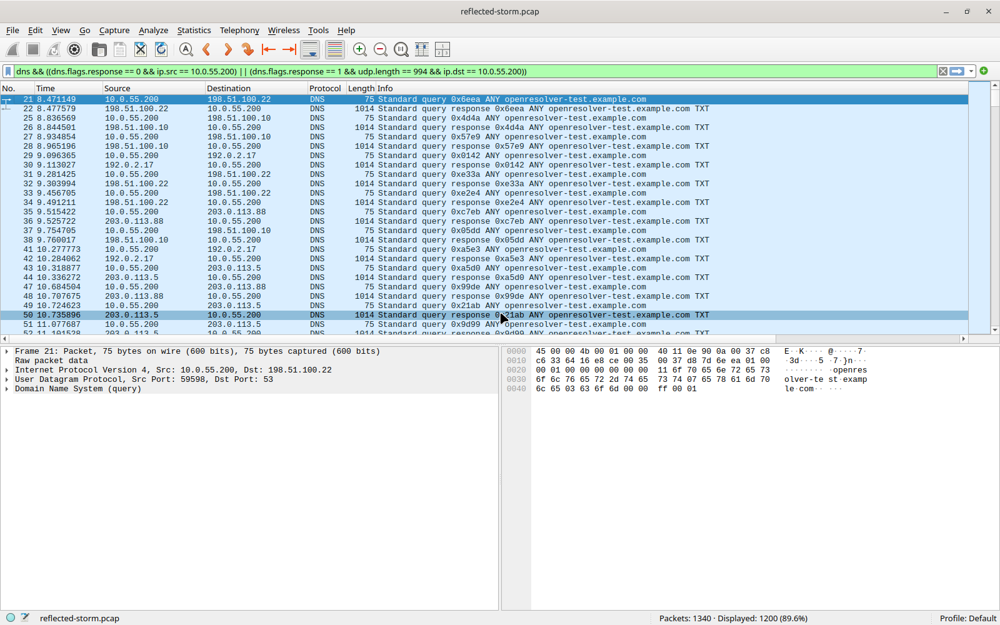

### Step 2 — Identify the Victim

Large responses from UDP source port 53 were isolated with:

```bash
tcpdump -nn -r reflected-storm.pcap \
  'udp src port 53 and dst host 10.0.55.200'
```

This filter returned exactly:

```text
600
```

packets. Every large response was sent to:

```text
10.0.55.200
```

Therefore, the system being hammered by reflected traffic is:

```text
Victim: 10.0.55.200
```

### Step 3 — Count the Reflectors

The source addresses of the 600 large DNS replies were grouped by IP address. Five distinct resolvers participated:

```text
192.0.2.17:      119 amplified responses
198.51.100.10:   118 amplified responses
198.51.100.22:   133 amplified responses
203.0.113.5:     120 amplified responses
203.0.113.88:    110 amplified responses
```

The response counts total 600:

```text
119 + 118 + 133 + 120 + 110 = 600
```

Thus, the attacker abused:

```text
5 reflectors
```

### Reproducible Extraction

A dependency-free classic-PCAP parser was saved in the challenge folder:

```text
Reflected Storm/solve_reflected_storm.py
```

It parses the global PCAP header, raw IPv4 headers, UDP headers, and DNS headers/questions/answer types. It isolates large DNS replies from UDP source port 53, pairs them with the victim-sourced triggers by transaction ID and transport tuple, verifies `ANY` requests and TXT answers, selects the destination receiving the dominant amplification stream, and counts the unique response sources.

Run it with:

```bash
cd 'Reflected Storm'
python3 solve_reflected_storm.py reflected-storm.pcap
```

Actual output:

```text
[+] Capture: reflected-storm.pcap
[+] IPv4/UDP packets parsed: 1340
[+] Amplified DNS responses (UDP >= 500 bytes): 600
[+] Victim: 10.0.55.200
[+] Reflectors (5):
    192.0.2.17: 119 amplified responses
    198.51.100.10: 118 amplified responses
    198.51.100.22: 133 amplified responses
    203.0.113.5: 120 amplified responses
    203.0.113.88: 110 amplified responses
[+] Matched DNS request/response pairs: 600
[+] DNS semantics: queries=ANY (all=True), answers include TXT (all=True),
    response rcode=NOERROR (all=True)
[+] Example trigger: packet 21  10.0.55.200:59598 -> 198.51.100.22:53
    ANY? openresolver-test.example.com
[+] Example reflection: packet 22  198.51.100.22:53 -> 10.0.55.200:59598
    UDP length=994, answer=TXT
[+] Flag: FLOWTRIQ{10.0.55.200_5_reflectors}
```

The rendered solver-output image below complements the native Wireshark view. It keeps the parsed DNS semantics, five reflector counts, matched packet pair, shared victim, and final flag visible in one image:

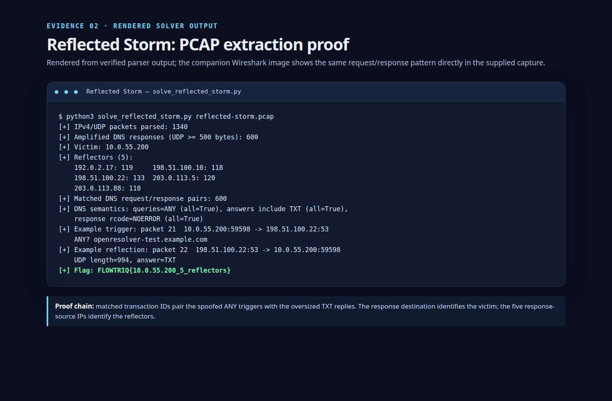

The corresponding plain-text output is retained at:

```text
Reflected Storm/assets/solver-output.txt
```

### Attack Chain

```text
Attacker spoofs 10.0.55.200 as the source address
        |
        v
Sends small DNS ANY requests to open resolvers
        |
        v
Resolvers generate much larger TXT responses
        |
        v
Responses converge on 10.0.55.200
        |
        v
Group UDP/53 response sources
        |
        v
Count five abused reflectors
```

### Evidence Files

| File | Purpose |
| --- | --- |
| `Reflected Storm/reflected-storm.pcap` | Original Raw IPv4 packet capture |
| `Reflected Storm/solve_reflected_storm.py` | Reproducible PCAP, victim, and reflector-count parser |
| `Reflected Storm/assets/wireshark-amplification-proof.png` | Native Wireshark view of spoofed ANY queries and TXT reflections in the supplied PCAP |
| `Reflected Storm/assets/solver-output.txt` | Actual parser output with DNS semantic checks, matched packet pair, victim, and reflector count |
| `Reflected Storm/assets/solver-proof.png` | Rendered visual proof of the successful parser output |
| `Reflected Storm/assets/solver-proof.html` | Source page used to render the solver proof image |

### Key Findings

```text
Attack type:              DNS reflection/amplification
Victim:                   10.0.55.200
Amplified response count: 600
UDP response length:      994 bytes
DNS payload length:       986 bytes
Trigger query type:       ANY
Reflected answer type:    TXT
Matched query/reply pairs: 600
Reflector count:          5
Reflectors:               192.0.2.17
                          198.51.100.10
                          198.51.100.22
                          203.0.113.5
                          203.0.113.88
```

### Final Flag

```text
FLOWTRIQ{10.0.55.200_5_reflectors}
```

### Conclusion

The packet capture shows a DNS amplification attack directed at `10.0.55.200`. The attacker used spoofed-source `ANY` queries to make five DNS reflectors emit much larger TXT responses toward the victim. Counting the distinct resolver addresses responsible for the 600 large UDP/53 responses yields five reflectors.

The key network-forensics lesson is to distinguish the apparent source of spoofed requests from the actual victim. During reflection attacks, the victim's address appears in both directions: as the spoofed source of the small trigger packets and as the destination of the amplified replies. The latter traffic identifies the host suffering the attack.

---

## Challenge 10 — LeafSync

### Challenge Details

| Field | Information |
| --- | --- |
| Competition | SecLeaf Q4 CTF 2026 |
| Challenge | LeafSync |
| Category | Network Forensics |
| Solver | LOH JUN SHENG |
| Points | Not provided |
| Supplied file | `LeafSync/leafsync.pcap` |
| Flag format | `SecLeaf{}` |
| Status | Solved |

### Challenge Prompt

> A developer workstation downloaded a synchronization helper from an internal documentation server. Soon afterward, it started sending repeated DNS queries to an unfamiliar domain.
>
> Analyze the supplied packet capture and determine what data was exfiltrated.

### Overview

The capture records a developer workstation downloading `leafsync-helper.sh` from an internal documentation server and then issuing six ordered DNS queries to the unfamiliar parent domain `sync-cache.training.local`.

The first two labels of each suspicious query form a sequence number and a Base64 fragment. Sorting the packets by the numeric label, concatenating the fragments, and Base64-decoding the result recovers the exfiltrated data.

### Initial File Inspection

The capture was identified and hashed before inspection:

```bash
file leafsync.pcap
sha256sum leafsync.pcap
capinfos leafsync.pcap
```

Relevant output:

```text
leafsync.pcap: pcap capture file, microsecond ts (little-endian)
- version 2.4 (Ethernet, capture length 65535)

e991e8f834315e9ebd341cdcf2db5c051a922abc806a607dc869237268f53bae  leafsync.pcap

Number of packets:   55
File size:           6,191 bytes
Data size:           5,287 bytes
Capture duration:    3.795607 seconds
Earliest packet time: 2026-09-29 21:16:55.075055
Latest packet time:   2026-09-29 21:16:58.870662
Encapsulation:       Ethernet
```

### Step 1 — Confirm the Helper Download

The workstation is `10.20.30.15`. It establishes an HTTP session to `10.20.30.80`, the internal documentation server. Packet 24 contains the request:

```http
GET /tools/leafsync-helper.sh HTTP/1.1
Host: docs.internal.local
User-Agent: curl/8.5.0
Accept: */*
Connection: close
```

Packet 25 returns the helper file:

```http
HTTP/1.1 200 OK
Server: InternalDocs/2.5
Content-Type: text/x-shellscript
Content-Disposition: attachment; filename=leafsync-helper.sh
Content-Length: 52

#!/bin/sh
echo 'LeafSync helper started'
```

This confirms the scenario's initial event: the developer workstation downloaded `leafsync-helper.sh` from `docs.internal.local` immediately before the suspicious DNS sequence.

### Step 2 — Isolate the Suspicious DNS Requests

Following the download, `10.20.30.15` sent six DNS A-record queries to names under:

```text
sync-cache.training.local
```

The resolver returned `NXDomain` for each request. The failed lookups are significant because the parent domain is unfamiliar and the leftmost labels are structured like ordered data fragments rather than normal hostnames.

The six requests, preserved in capture order, are:

```text
Packet 36: 01.U2VjTGVh.sync-cache.training.local
Packet 38: 02.ZntkbnNf.sync-cache.training.local
Packet 40: 03.bGFiZWxz.sync-cache.training.local
Packet 42: 04.X2hpZGVf.sync-cache.training.local
Packet 44: 05.dGhlX3Ry.sync-cache.training.local
Packet 46: 06.dXRofQ==.sync-cache.training.local
```

A Wireshark display filter that isolates the six malicious requests is:

```text
dns.flags.response == 0 && dns.qry.name contains "sync-cache.training.local"
```

The numeric labels `01` through `06` provide the required ordering. The following label in each name uses the Base64 character set, and the final fragment includes `==` padding.

### Native Wireshark Packet Proof

The following request-and-response filter isolates the complete suspicious DNS sequence in the original capture:

```text
dns && dns.qry.name contains "sync-cache.training.local"
```

The native Wireshark screenshot retains the display filter, packets 36 through 47, source and resolver endpoints, full ordered query names, and each adjacent `No such name` response. It directly shows the six outbound data-bearing labels and their NXDOMAIN replies.

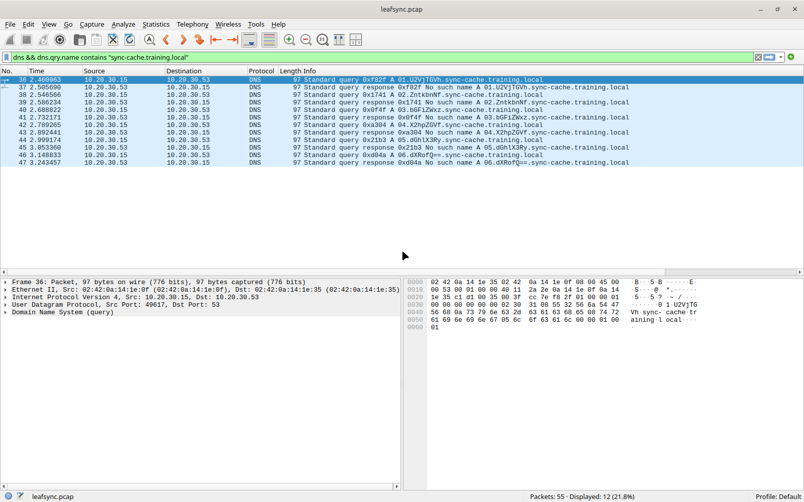

### Step 3 — Reconstruct the Exfiltrated Data

First, discard the sequence number and fixed parent domain. Then concatenate the changing Base64 fragments in numeric order:

```text
U2VjTGVh
ZntkbnNf
bGFiZWxz
X2hpZGVf
dGhlX3Ry
dXRofQ==
```

Reconstructed value:

```text
U2VjTGVhZntkbnNfbGFiZWxzX2hpZGVfdGhlX3RydXRofQ==
```

The result is valid Base64 and decodes with:

```bash
printf '%s' 'U2VjTGVhZntkbnNfbGFiZWxzX2hpZGVfdGhlX3RydXRofQ==' | base64 -d
```

Output:

```text
SecLeaf{dns_labels_hide_the_truth}
```

### Reproducible Extraction

A dependency-free extractor was saved with the challenge:

```text
LeafSync/solve_leafsync.py
```

It parses the classic PCAP format, Ethernet, IPv4, TCP, UDP, and DNS question records. It confirms the HTTP helper request and response, identifies requests under the suspicious parent domain, validates the sequence labels, matches the six DNS replies by transaction ID and ports, verifies their NXDOMAIN response codes, joins the fragments, and Base64-decodes the recovered data.

Run it with:

```bash
cd LeafSync
python3 solve_leafsync.py leafsync.pcap
```

Actual output:

```text
[+] Capture: leafsync.pcap
[+] HTTP helper request/response text found: packets 24/25
[+] Download path: /tools/leafsync-helper.sh
[+] LeafSync helper content observed: True
[+] Suspicious parent domain: sync-cache.training.local
[+] Exfiltrating workstation: 10.20.30.15
[+] Ordered DNS fragments (6):
    packet 36: 10.20.30.15  01.U2VjTGVh
    packet 38: 10.20.30.15  02.ZntkbnNf
    packet 40: 10.20.30.15  03.bGFiZWxz
    packet 42: 10.20.30.15  04.X2hpZGVf
    packet 44: 10.20.30.15  05.dGhlX3Ry
    packet 46: 10.20.30.15  06.dXRofQ==
[+] Matching DNS responses: 6/6, rcode=NXDOMAIN (all=True)
[+] Reconstructed Base64: U2VjTGVhZntkbnNfbGFiZWxzX2hpZGVfdGhlX3RydXRofQ==
[+] Decoded data: SecLeaf{dns_labels_hide_the_truth}
```

The rendered parser-output image below complements the native Wireshark proof. It records the helper-download context, suspicious parent domain, ordered packet fragments, matched NXDOMAIN replies, reconstructed Base64, and decoded result:

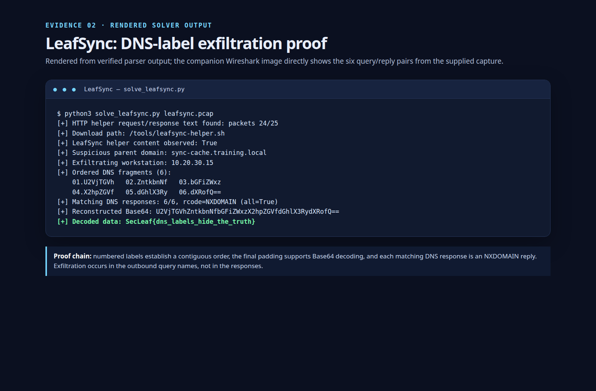

The plain-text output is retained at:

```text
LeafSync/assets/solver-output.txt
```

### Exfiltration Chain

```text
Developer workstation downloads leafsync-helper.sh
        |
        v
DNS queries begin immediately afterward
        |
        v
Identify repeated requests to sync-cache.training.local
        |
        v
Use numeric labels to preserve fragment order
        |
        v
Strip the fixed parent domain
        |
        v
Concatenate the Base64-like labels
        |
        v
Base64-decode the reconstructed value
        |
        v
Recover the exfiltrated data
```

### Evidence Files

| File | Purpose |
| --- | --- |
| `LeafSync/leafsync.pcap` | Original Ethernet packet capture |
| `LeafSync/solve_leafsync.py` | Reproducible HTTP-context and DNS-label extraction script |
| `LeafSync/assets/wireshark-dns-proof.png` | Native Wireshark proof of all six query/reply pairs and the NXDOMAIN response context |
| `LeafSync/assets/solver-output.txt` | Actual extraction output with ordered fragments and DNS-response verification |
| `LeafSync/assets/solver-proof.png` | Rendered visual proof of the successful extraction |
| `LeafSync/assets/solver-proof.html` | Source page used to render the proof image |

### Key Findings

```text
Workstation:          10.20.30.15
Documentation server: 10.20.30.80 (docs.internal.local)
Downloaded helper:    /tools/leafsync-helper.sh
Suspicious domain:    sync-cache.training.local
DNS exfiltration:     Six numbered Base64 fragments
DNS response status:  NXDomain for all six requests
```

### Final Flag

```text
SecLeaf{dns_labels_hide_the_truth}
```

### Conclusion

LeafSync demonstrates DNS-label data exfiltration. The workstation downloaded a helper from the internal documentation server, then sent six lookups to an otherwise unfamiliar domain. Rather than using the DNS response, the sender placed encoded data in the request labels themselves. The sequence numbers preserve fragment order, and the final `==` padding makes the Base64 encoding especially clear.

The main forensics lesson is that DNS request names must be inspected even when responses are failures. `NXDomain` replies do not prevent exfiltration: the attacker only needs the recursive resolver to receive and forward the query name containing the data.

---

## Challenge 11 — Null Choir

### Challenge Details

| Field | Information |
| --- | --- |
| Competition | SecLeaf Q4 CTF 2026 |
| Challenge | Null Choir |
| Category | Reverse Engineering |
| Solver | LOH JUN SHENG |
| Points | Not provided |
| Challenge folder | `Null Choir/` |
| Supplied files | `null_choir`, `canticle.score`, `echoes.trace` |
| Flag format | `SecLeaf{}` |
| Status | Solved |

### Challenge Prompt

> I wanted to make a difficult reversing challenge.
>
> I think I may have overdone it a little (again :<). Anyways, enjoy the concert. The screaming is complimentary.

### Overview

`null_choir` is a stripped 64-bit PIE ELF verifier with two required companion files. It requires a 48-byte candidate and does not compare that candidate with a plaintext flag. Instead, the binary derives six 64-bit state words from the candidate, executes a 4,096-instruction virtual machine, and checks the transformed state against encrypted target bytes in `canticle.score`.

The companion artifacts are essential:

- `canticle.score` contains an `NCS2` header, three encrypted VM-record banks, and the final target bytes.
- `echoes.trace` contains an `ECH8` trace whose integrity-checked records seed the VM's auxiliary state.

Although the verifier is deliberately large, every dispatched VM operation and each 64-step boundary mixer is reversible. The solution therefore reconstructs the final target state, applies the inverse operations in reverse order, undoes the initial six-word transform, and recovers the exact accepted 48-byte input.

### Initial File Inspection

The three supplied files were identified and hashed before reverse engineering:

```bash
file null_choir canticle.score echoes.trace
sha256sum null_choir canticle.score echoes.trace
```

Actual output:

```text
null_choir: ELF 64-bit LSB pie executable, x86-64, dynamically linked, stripped
canticle.score: data
echoes.trace:   data

4ac5a87928fef253dd08009cee440c7c475d7d9788d767d043d25d79bc0e70d8  null_choir
7d7c7445a50f0089524fc0e6b876c94b857f35ca6638e5024ee465a95e150f09  canticle.score
14c28a0555e06d366088e740ba6805118333cf7f41f809475482875db87e322e  echoes.trace
```

The binary imports `fopen`, `fread`, `fseek`, `ftell`, and `rewind`, while its `.rodata` strings name both companion files. This establishes that the executable is not standalone and must be run beside both files.

The two binary containers begin with distinct magic values:

```text
$ xxd -g 1 -l 16 canticle.score
00000000: 4e 43 53 32 00 10 00 00 31 ec dd 78 e6 e5 1f 30  NCS2....1..x...0

$ xxd -g 1 -l 16 echoes.trace
00000000: 45 43 48 38 20 90 cf ca 49 16 04 45 6a c6 c0 21  ECH8 ...I..Ej..!
```

### Step 1 — Establish the Input and Container Geometry

The executable checks the candidate length against `0x30`, so the accepted input is exactly 48 bytes. It also requires the score file size to be:

```text
0x100 + 0x30 × 0x1000 = 0x30100 bytes = 196,864 bytes
```

`canticle.score` has that exact size. Its `NCS2` header stores a VM-step count of `0x1000` (4,096), followed by three 64-KiB banks of encrypted 16-byte VM records. The selected bank is derived from trace-dependent state rather than chosen from user input.

`echoes.trace` is 3,104 bytes long. After its 0x20-byte header, it contains 192 16-byte trace entries. The verifier accepts only entries with the expected `EC` tag/type and a valid FNV-1a checksum over the entry's first 12 bytes.

### Step 2 — Reconstruct the Trace-Derived State

The score header supplies a trace type byte. The solver selects matching `ECH8` entries, validates their FNV-1a checksums, and incorporates their payloads into an auxiliary-state array. The ELF uses a SplitMix64-style mixer repeatedly:

```text
x ^= x >> 30
x *= 0xbf58476d1ce4e5b9
x ^= x >> 27
x *= 0x94d049bb133111eb
x ^= x >> 31
```

This reconstructed state determines both the score bank and the per-record decryption stream. The verified run reported:

```text
score_header=0x301fe5e678ddec31
rbp=0x866a952e86bb7d8b
score_bank=0
trace_key=0xe5
```

### Step 3 — Decrypt and Validate the 4,096 VM Records

For every VM step, the solver derives a record index from the mixed trace state, selects one encrypted 16-byte record from the chosen score bank, and XOR-decrypts it with a step-specific keystream.

The decrypted record format is checked before it is used:

```text
destination register: 0 through 5
source register:      0 through 5
rotation count:       1 through 63
step tag:             current step modulo 256
fixed marker:         7a a7
```

All 4,096 records passed these structural checks. Their opcode selector dispatches one of 24 transformations over six 64-bit VM registers. The instruction set includes XOR, addition/subtraction modulo `2^64`, rotations, swaps, byte swaps, bit reversal, and mixer-based operations.

### Step 4 — Invert the VM

The final verifier does not compare the original candidate directly. It XORs the final six-register state with target bytes from `canticle.score` and a generated stream. This makes the desired post-VM state recoverable.

The solver then performs the following inverse process:

```text
Build the desired final six-word state from score target bytes
        |
        v
Walk VM instructions from step 4095 down to step 0
        |
        v
Undo the boundary mixer after every 64-instruction block
        |
        v
Undo the selected reversible opcode
        |
        v
Undo the initial per-word rotation and SplitMix64-style masking
        |
        v
Recover six little-endian 64-bit words = 48-byte candidate
```

The solver forwards the recovered candidate through its own VM implementation and requires the result to match the reconstructed target state exactly. This round-trip check prevents a plausible but incorrect inverse result.

### Reproducible Solver

A dependency-free static solver is saved with the challenge:

```text
Null Choir/solve_null_choir.py
```

Run it from the challenge folder:

```bash
cd 'Null Choir'
python3 solve_null_choir.py
```

Actual output:

```text
score_header=0x301fe5e678ddec31 rbp=0x866a952e86bb7d8b score_bank=0 trace_key=0xe5
validated_vm_records=4096
candidate_hex=5365634c6561667b7468335f63683031725f73316e67355f316e5f3568346430775f6d346368316e333521212121217d
candidate_ascii=b'SecLeaf{th3_ch01r_s1ng5_1n_5h4d0w_m4ch1n35!!!!!}'
```

The exact output is retained at:

```text
Null Choir/assets/solver-output.txt
```

### Step 5 — Validate Against the Original Verifier

The supplied binary lacked execute permission, so validation was performed using a disposable copy together with both required companion files:

```bash
work=$(mktemp -d)
cp null_choir canticle.score echoes.trace "$work"
chmod 700 "$work/null_choir"
(cd "$work" && ./null_choir \
  'SecLeaf{th3_ch01r_s1ng5_1n_5h4d0w_m4ch1n35!!!!!}')
```

Actual output:

```text
Harmony.
[+] Exit code: 0
```

`Harmony.` and a zero exit code are the program's success condition. The disposable copies used for validation were hash-matched against all three supplied originals before execution.

### Solver Proof

The rendered evidence below combines the original container magic values, the 4,096-record solver result, recovered candidate, and successful original-binary validation:

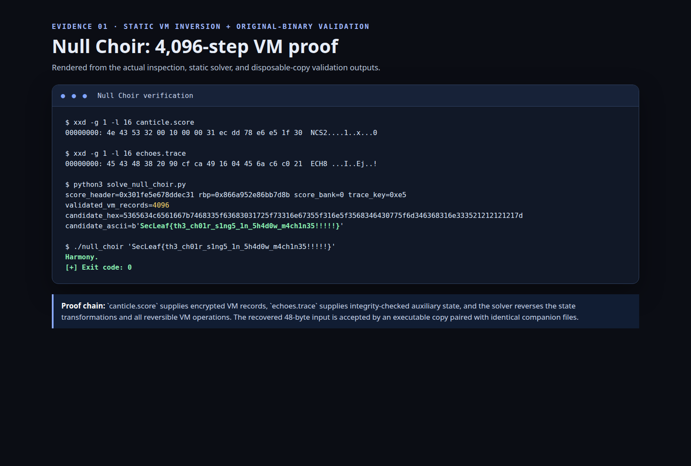

### Evidence Files

| File | Purpose |
| --- | --- |
| `Null Choir/null_choir` | Original stripped PIE ELF verifier |
| `Null Choir/canticle.score` | Original `NCS2` score container with encrypted VM records and target bytes |
| `Null Choir/echoes.trace` | Original `ECH8` integrity-checked trace container |
| `Null Choir/solve_null_choir.py` | Reproducible static trace parser, record decryptor, VM inverter, and round-trip verifier |
| `Null Choir/assets/static-inspection.txt` | Exact file-type, hash, and magic-byte inspection output |
| `Null Choir/assets/solver-output.txt` | Exact successful solver output |
| `Null Choir/assets/binary-validation.txt` | Original-verifier success response and exit code from the disposable-copy run |
| `Null Choir/assets/solver-proof.html` | Source page for the rendered proof image |
| `Null Choir/assets/solver-proof.png` | Visual proof of static recovery and binary acceptance |

### Key Findings

```text
Required candidate length: 48 bytes
Score container:          NCS2
Trace container:          ECH8
Selected score bank:      0
Trace-derived key type:   0xe5
VM records:               4,096
VM registers:             6 × 64-bit
Opcode families:          24 reversible transformations
Original verifier result: Harmony. (exit code 0)
```

### Final Flag

```text
SecLeaf{th3_ch01r_s1ng5_1n_5h4d0w_m4ch1n35!!!!!}
```

### Conclusion

Null Choir is difficult because it layers two validated binary containers, trace-derived state, encrypted VM records, a large opcode dispatch, periodic state mixers, and a final state comparison. However, complexity alone does not prevent recovery when every transformation is reversible and all keys are locally derivable from supplied data.

The key reverse-engineering lesson is to avoid brute-forcing the 48-byte candidate. Instead, model the verifier as a state transformation, recover the required final state, and run the transformation backwards. The independently reproduced `Harmony.` response confirms that the recovered flag is accepted by the original logic.

---

## Challenge 12 — Blackout Protocol

### Challenge Details

| Field | Information |
| --- | --- |
| Competition | SecLeaf Q4 CTF 2026 |
| Challenge | Blackout Protocol |
| Category | Reverse Engineering / Forensics |
| Solver | LOH JUN SHENG |
| Points | Not provided |
| Challenge folder | `Blackout Protocol/` |
| Supplied files | `blackout_protocol`, `transmission.pcap`, `retained.mem`, `incident.journal` |
| Flag format | `SecLeaf{}` |
| Status | Solved |

### Challenge Prompt

> Everything went dark, the logs are a mess, and apparently I'm supposed to call this an incident response exercise.
>
> I'm sure all the evidence is completely trustworthy. Surely.

### Overview

`blackout_protocol` is a stripped 64-bit PIE verifier that combines three companion artifacts. The incident narrative is intentionally misleading: not every packet or journal entry is trusted. The executable derives a marker from `retained.mem`, uses it to select integrity-checked journal records, processes the PCAP in its physical record order, then checks a transformed 48-byte candidate against an artifact-derived target.

The solution avoids treating timestamps, packet source addresses, or all log entries as authoritative. Instead, it reproduces the verifier's artifact checks and inverts its 52 reversible candidate-transformation rounds.

### Initial Inspection and Integrity Baseline

The following commands were run before executing any copy of the supplied ELF:

```bash
cd 'Blackout Protocol'
file blackout_protocol transmission.pcap retained.mem incident.journal
sha256sum blackout_protocol transmission.pcap retained.mem incident.journal
capinfos transmission.pcap
```

The original hashes recorded by the solver are:

```text
8b03bd3928ed0c362c193c88533dcbf3e8d05cc61146e1f7dc8ffa61773bb529  blackout_protocol
fe5a71d9509942fe2b04c344ae17ae1f3a028fd14bc90628ddac324c15f0e392  transmission.pcap
848661122b5c8c3ad729085fe0626f10d1945f1a8f9aab582a80f76e7c149d28  retained.mem
8e4346f69be0a9dcd8a90406a8560bfda219701637424357f6eb3f702864e857  incident.journal
```

`transmission.pcap` is a classic little-endian Ethernet PCAP with 290 packets. `capinfos` reports `Strict time order: False`, so the timestamps cannot safely be used to reorder records. The supplied executable is not standalone: its read-only strings name all three companion files and it imports the file-reading functions needed to load them.

### Step 1 — Establish the Artifact Trust Rules

The verifier requires `retained.mem` to be exactly `0x4000` bytes and checks for `M16B` at offset `0x180`:

```text
00000180: 4d 31 36 42 37 ea 34 11 0b 15 c7 07 9c 10 95 49  M16B7.4........I
```

The next byte is the selector `0x37` (ASCII `7`). That byte binds the three artifacts:

- `incident.journal` begins with `JRN4` and contains 224 fixed 24-byte records after its 32-byte header.
- A journal record is eligible only when it begins `JR`, has selector byte `0x37`, has an ID below 48, and has a valid FNV-1a-32 checksum over its first 12 bytes.
- Exactly 48 records meet those conditions, and their IDs cover every value from `0` through `47` once.
- All 290 UDP payloads in the PCAP are 24 bytes and begin `BKP5`; 240 carry the same selector byte `0x37`, producing the raw prefix `BKP57`.

This selection process is why the challenge's evidence cannot be accepted at face value. The remaining journal records and packets are not automatically input to the verifier.

### Step 2 — Preserve PCAP File Order

The traffic consists of packets to two destination ports and from two apparent sources:

```text
UDP records:              290
Source counts:            10.64.0.1 = 254, 10.64.0.51 = 36
Destination port counts:  31337 = 240, 31338 = 50
Payload length:           24 bytes for every UDP record
```

The capture has timestamp inversions after physical records 110 and 220. In other words, record 111 has an earlier timestamp than record 110, and record 221 has an earlier timestamp than record 220. The verifier walks the original PCAP record sequence and incorporates packet fields while building its state, so sorting by displayed timestamps would alter the data stream and break recovery.

The binary then applies additional endpoint, header, integrity, and index checks to the selected packet frames. The solver leaves the PCAP in on-disk record order rather than trusting the timeline display or every apparent source address.

#### Native PCAP Evidence — Selected Stream

The following Wireshark screenshot is from the original PCAP. Its display filter is:

```text
udp.dstport == 31337 && ip.src == 10.64.0.1 && udp.payload[4] == 0x37
```

It visibly shows the capture order, endpoint tuple, UDP protocol, packet lengths, and a selected raw payload whose ASCII pane contains `BKP57`. This is a narrow visual example of the selector-based stream, not a claim that all 240 selector-matching packets satisfy the verifier's later integrity checks.

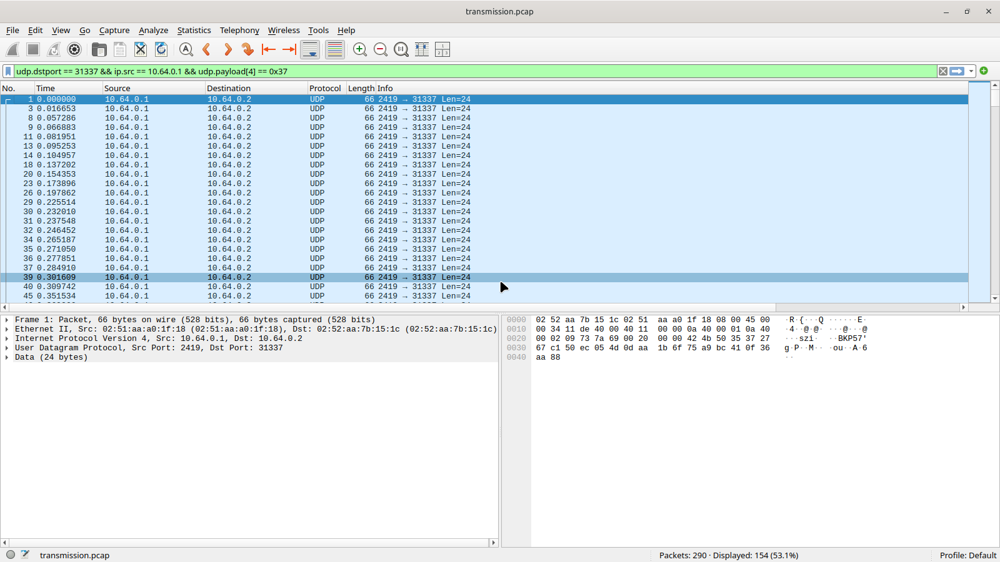

#### Native PCAP Evidence — Timestamp Inversions

This second Wireshark view filters the four boundary packets directly:

```text
frame.number == 110 || frame.number == 111 || frame.number == 220 || frame.number == 221
```

The rows show physical packet number 111 with an earlier displayed time than 110, and packet 221 with an earlier displayed time than 220. It is direct native-viewer evidence for retaining PCAP file order.

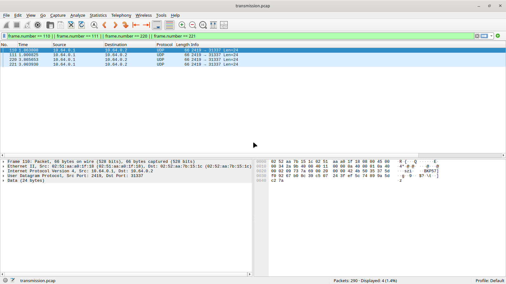

### Step 3 — Recover the Artifact-Derived Target

After validating the journal and packet structures, the verifier creates a 256-byte substitution table and a 384-byte target state. It uses a SplitMix64-style mixer repeatedly:

```text
x ^= x >> 30
x *= 0xbf58476d1ce4e5b9
x ^= x >> 27
x *= 0x94d049bb133111eb
x ^= x >> 31
```

The target is entirely derived from the supplied, hash-checked artifacts. The reproducible solver obtains this post-artifact state from a GDB run of a disposable binary copy; the original ELF and evidence files are never modified.

#### Debugger Checkpoint Evidence

The solver first stops at verifier offset `0x193b`, where GDB exposes the artifact-derived seed in `r15` and the address of the generated 256-byte substitution table in `r13`. It then stops at `0x1b3a`, immediately after the artifact pipeline has produced the transformed probe output and before the verifier's 384-byte target state is consumed.

The image below is explicitly a rendered excerpt of the captured GDB output, not a native terminal screenshot. The full unabridged command output is retained in `Blackout Protocol/assets/gdb-state-extraction.txt`; it shows both breakpoint addresses, register values, S-box bytes, and the beginning/end excerpts of the target-state buffer.

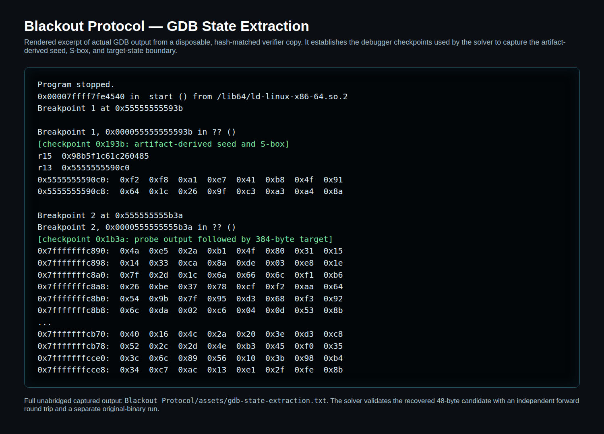

### Step 4 — Invert the Candidate Transform

The program demands an exact 48-byte input and subjects it to 52 rounds. Each round performs:

```text
keyed S-box substitution
        |
        v
round-dependent permutation
        |
        v
forward rolling add/rotate chain
        |
        v
reverse rolling XOR/rotate chain
        |
        v
periodic mutation round (every 7th or 13th round)
```

Every operation is reversible. The solver constructs the required final 48-byte state from the artifact-derived target and memory bytes, then processes the rounds backward. It finally runs the recovered bytes through a forward implementation and requires an exact round-trip match before executing the verifier copy.

### Reproducible Solver

The solver is stored with the challenge:

```text
Blackout Protocol/solve_blackout_protocol.py
```

It requires `python3` and `gdb`. Run it from the repository root or provide the challenge-folder path:

```bash
python3 'Blackout Protocol/solve_blackout_protocol.py' 'Blackout Protocol'
```

Actual output:

```text
artifact checks: 290 UDP BKP5 frames; 240 BKP37 candidates; 48 authenticated JR records
accepted input: SecLeaf{n01s3_1n_th3_w1r35_4nd_4ft3r1m4g3s!!!!!}
binary validation: Authenticated.
```

`BKP37` in the output prints the selector in hexadecimal (`0x37`); in raw ASCII the five-byte prefix is `BKP57`.

### Step 5 — Validate Against the Original Verifier

The supplied binary was validated only from a temporary directory containing hash-matched copies of all four supplied files:

```bash
work=$(mktemp -d)
cp 'Blackout Protocol'/blackout_protocol \
   'Blackout Protocol'/transmission.pcap \
   'Blackout Protocol'/retained.mem \
   'Blackout Protocol'/incident.journal "$work"/
chmod 700 "$work/blackout_protocol"
(cd "$work" && ./blackout_protocol \
  'SecLeaf{n01s3_1n_th3_w1r35_4nd_4ft3r1m4g3s!!!!!}')
```

Actual output:

```text
Authenticated.
[+] Exit code: 0
```

`Authenticated.` with exit code `0` is the verifier's success condition.

### Solver Proof

The rendered proof card summarizes the original-format checks, the selector-based filtering, the non-monotonic capture order, the inversion round-trip, and binary acceptance:

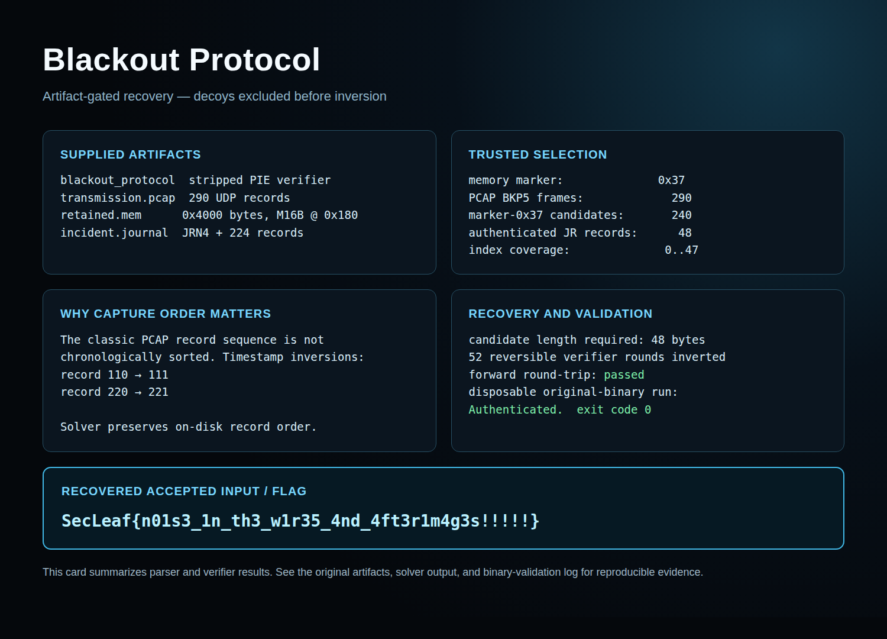

### Evidence Files

| File | Purpose |
| --- | --- |
| `Blackout Protocol/blackout_protocol` | Original stripped PIE verifier |
| `Blackout Protocol/transmission.pcap` | Original 290-record Ethernet/UDP capture |
| `Blackout Protocol/retained.mem` | Original 16-KiB memory artifact containing the `M16B` marker and selector |
| `Blackout Protocol/incident.journal` | Original `JRN4` journal with valid and decoy records |
| `Blackout Protocol/solve_blackout_protocol.py` | Hash-checking artifact parser, target extractor, reversible-transform inverter, round-trip verifier, and disposable binary validator |
| `Blackout Protocol/assets/static-inspection.txt` | File types, hashes, marker/header bytes, PCAP scope, and deterministic artifact counts |
| `Blackout Protocol/assets/wireshark-selected-stream.png` | Native Wireshark view of the selector-matching packet stream and raw `BKP57` payload bytes |
| `Blackout Protocol/assets/wireshark-record-order.png` | Native Wireshark view of physical packets 110/111 and 220/221 showing the two timestamp inversions |
| `Blackout Protocol/assets/gdb-state-extraction.txt` | Unabridged GDB checkpoint output from the disposable verifier copy |
| `Blackout Protocol/assets/gdb-state-proof.html` | Source page for the explicitly labeled rendered GDB-output excerpt |
| `Blackout Protocol/assets/gdb-state-proof.png` | Rendered readable excerpt of the actual GDB checkpoint output |
| `Blackout Protocol/assets/solver-output.txt` | Exact successful solver output |
| `Blackout Protocol/assets/binary-validation.txt` | `Authenticated.` response and exit code from the disposable-copy run |
| `Blackout Protocol/assets/solver-proof.html` | Source page for the rendered proof card |
| `Blackout Protocol/assets/solver-proof.png` | Visual summary of filtering, recovery, and acceptance evidence |

### Key Findings

```text
Required candidate length:       48 bytes
Memory magic / selector:         M16B / 0x37
Journal container:               JRN4
Journal records:                 224
Authenticated journal records:   48, IDs 0 through 47
PCAP records:                    290 fixed 24-byte UDP payloads
Selector-matching PCAP payloads: 240
PCAP timestamp inversions:       after records 110 and 220
Verifier transform:              52 reversible rounds
Original verifier result:        Authenticated. (exit code 0)
```

### Final Flag

```text
SecLeaf{n01s3_1n_th3_w1r35_4nd_4ft3r1m4g3s!!!!!}
```

### Conclusion

Blackout Protocol is an incident-response-themed reverse-engineering challenge in which the principal trap is misplaced trust. The PCAP contains out-of-order timestamps and alternate-channel traffic, while the journal contains records that fail the verifier's tag, checksum, or index requirements. The reliable evidence chain is the one encoded by the checker: verify immutable inputs, apply the memory-derived selector, preserve physical packet order, validate record integrity, and only then invert the 52-round transformation.

The disposable-copy `Authenticated.` result confirms that the recovered flag is accepted by the supplied original verifier.
