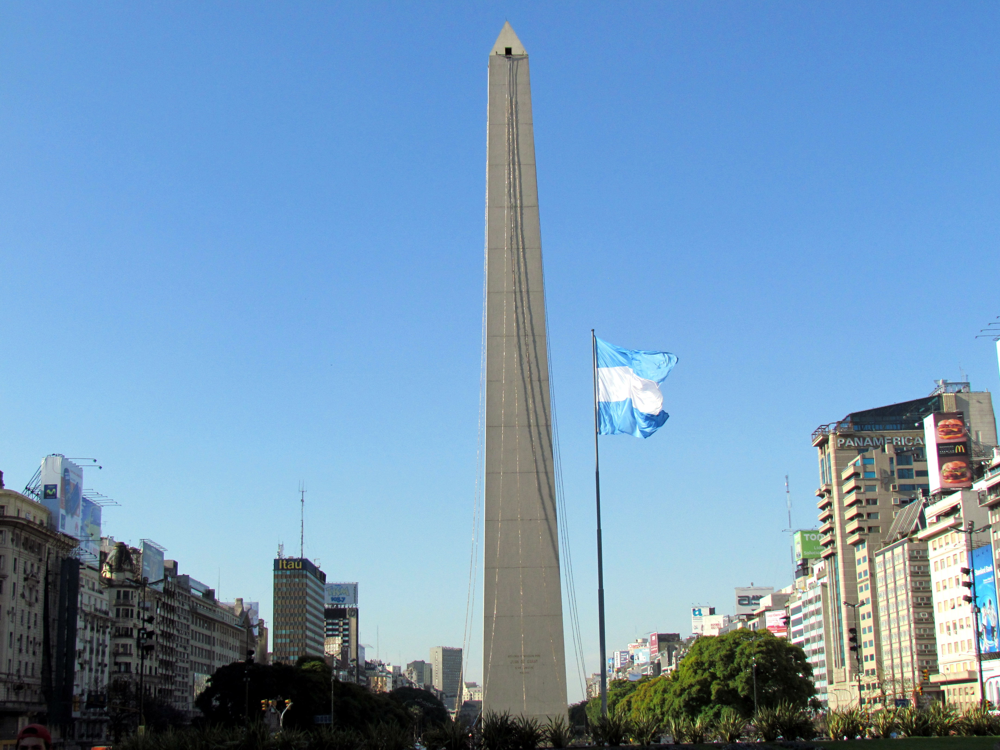
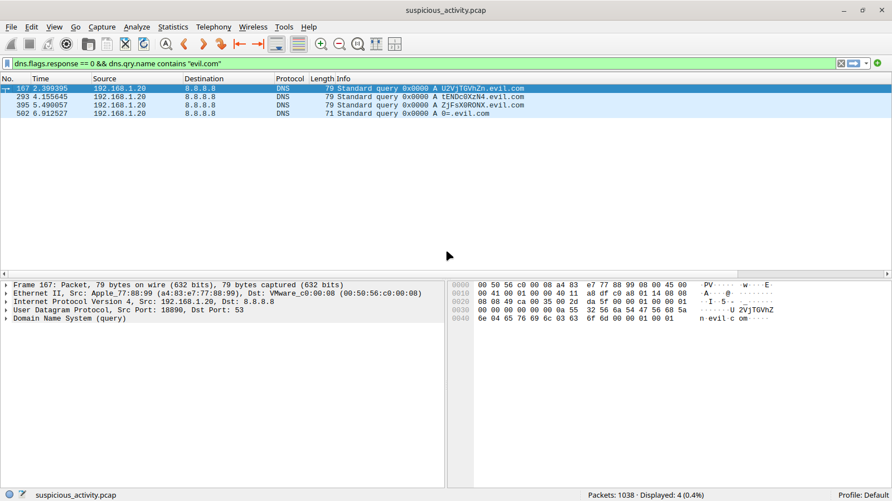
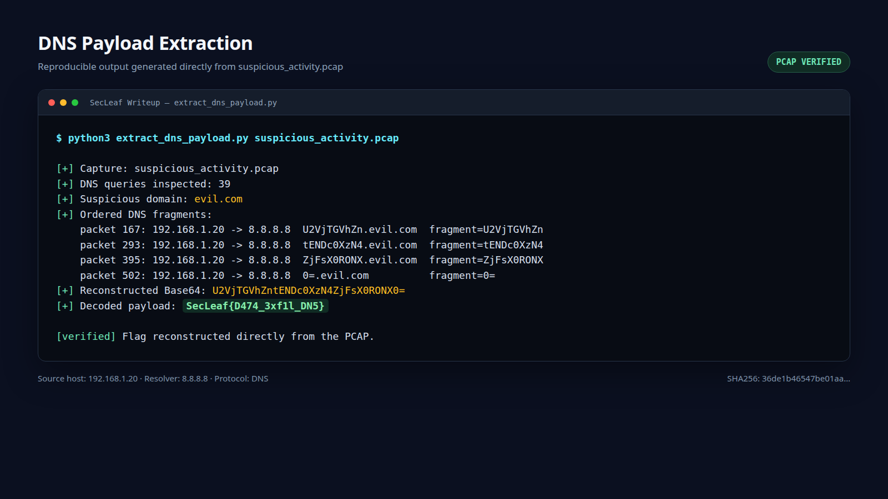
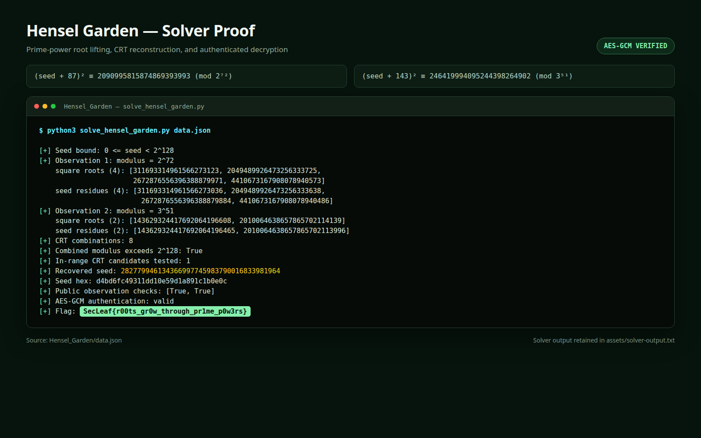

# SecLeaf Q4 CTF 2026 — Writeups

## Challenge 1 — Disguise of SecLeaf

## Challenge Details

| Field | Information |
| --- | --- |
| Competition | SecLeaf Q4 CTF 2026 |
| Challenge | Disguise of SecLeaf |
| Category | OSINT |
| Solver | LOH JUN SHENG |
| Points | Not provided |
| Flag format | `SecLeaf{}` |
| Status | Solved |

## Challenge Prompt

> You know you want me, you know you need me, Find me where I am a disguise of SecLeaf on Instagram.
>
> Flag format: `SecLeaf{}`

The challenge also supplied links to SecLeaf's public social-media accounts, including its official Instagram profile:

- Instagram: `https://www.instagram.com/secleafofficial/`
- LinkedIn: `https://www.linkedin.com/company/secleaf`
- YouTube: `https://www.youtube.com/@SecLeaf`

## Overview

This was an open-source intelligence challenge based on Instagram usernames and public comments. No vulnerability exploitation, authentication bypass, automated scanning, or private-account access was required.

The decisive phrase was:

> Find me where I am a disguise of SecLeaf on Instagram.

SecLeaf's official Instagram username is `@secleafofficial`, not simply `@secleaf`. The word "disguise" suggested that the answer might be associated with another account using SecLeaf's preferred or natural username. This led to an investigation of the exact Instagram handle `@secleaf`.

## Initial Observations

The supplied Instagram link opened the official account:

```text
@secleafofficial
```

The account name and profile description confirmed that it represented SecLeaf. However, the challenge did not ask us merely to inspect the official profile. It specifically referred to a place where something was a "disguise of SecLeaf."

The username was therefore the main clue:

```text
Organization: SecLeaf
Official Instagram handle: @secleafofficial
Natural matching handle: @secleaf
```

If the exact `@secleaf` username already belonged to another person, SecLeaf would have to operate under a modified handle such as `@secleafofficial`. This made `@secleaf` the strongest candidate for the disguised location described by the riddle.

## Enumeration and Analysis

### Step 1 — Inspect the official SecLeaf account

The official Instagram profile was opened from the link supplied with the challenge:

```text
https://www.instagram.com/secleafofficial/
```

The visible account information identified it as SecLeaf's cybersecurity-community profile. The important observation was that the organization used the extended username `secleafofficial` rather than the exact name `secleaf`.

### Step 2 — Interpret the word "disguise"

The phrase "a disguise of SecLeaf" was treated as a username-based clue. The official account's modified handle suggested that the exact handle might already be occupied.

The next step was therefore to replace the official username with the organization's exact name:

```text
secleafofficial  ->  secleaf
```

### Step 3 — Visit the exact `@secleaf` handle

The following public profile was opened:

```text
https://www.instagram.com/secleaf/
```

The profile was not the official cybersecurity-community account. It displayed:

```text
Username: secleaf
Display name: Broken Anna
Bio: I wish I have my Alice
Followers: 44
Following: 0
```

This result matched the riddle. The account used the exact SecLeaf name while presenting itself as an unrelated personal profile—effectively the "disguise" referenced by the challenge.

### Step 4 — Inspect the account's content

The `@secleaf` profile had only one visible post. The post was dated December 9, 2016 and was available at:

```text
https://www.instagram.com/secleaf/p/BNzU4gSDuLb/
```

Because there was only one post, it was the logical place to continue the investigation. The image itself did not visibly contain the flag, so the post caption and public comments were inspected.

### Step 5 — Review the public comments

A recent comment on the old post was made by the account `@satisfyingblends`. The comment contained a string in the required `SecLeaf{}` format:

```text
SecLeaf{w3_w4nt_th1s_4cc0unt}
```

The text matched the expected flag format exactly. Its meaning also confirmed the username interpretation:

```text
w3_w4nt_th1s_4cc0unt
-> "we want this account"
```

This indicated that SecLeaf wanted the exact `@secleaf` Instagram username but had to use `@secleafofficial` because the shorter handle belonged to the unrelated account.

## Key Insight

The challenge was solved by correlating three details:

1. The organization is named **SecLeaf**.
2. Its official Instagram handle is **`@secleafofficial`** rather than `@secleaf`.
3. The exact **`@secleaf`** handle belongs to a different profile with a single old post.

The word "disguise" pointed away from the obvious official account and toward the unrelated account occupying the exact username. The flag was then found in the comments on that account's only post.

## Flag Retrieval

The final navigation path was:

```text
Official SecLeaf Instagram
        |
        v
Notice the modified handle: @secleafofficial
        |
        v
Check the exact handle: @secleaf
        |
        v
Open its only post
        |
        v
Inspect the public comments
        |
        v
Recover the flag
```

### Proof

The screenshot below shows the public Instagram post and the comment containing the flag:


## Final Flag

```text
SecLeaf{w3_w4nt_th1s_4cc0unt}
```

## Conclusion

This challenge required careful interpretation of the wording rather than advanced tooling. The provided official Instagram link established the modified username, while the phrase "disguise of SecLeaf" suggested checking the exact `@secleaf` handle. The unrelated account using that handle contained one public post, and a recent comment on the post revealed the flag.

The main OSINT lesson is to examine usernames, naming variations, old public content, and comment sections. In social-media investigations, a modified official handle can reveal that the organization's preferred username is already controlled by another account.

---

## Challenge 2 — Shadow Chronometry

### Challenge Details

| Field | Information |
| --- | --- |
| Competition | SecLeaf Q4 CTF 2026 |
| Challenge | Shadow Chronometry |
| Category | OSINT |
| Solver | LOH JUN SHENG |
| Points | Not provided |
| Supplied file | `shadow_chronometry.jpg` |
| Flag format | `SecLeaf{latitude,longitude}` |
| Precision | Four decimal places |
| Status | Solved |

### Challenge Prompt

> Find coords.
>
> Flag Format: `SecLeaf{latitude,longitude}` — 4 decimal pts.

### Overview

This challenge supplied a single photograph and required the latitude and longitude of the landmark shown in it. The photograph contains a tall stone obelisk in the middle of a very wide urban avenue. An Argentine flag is flying beside the monument, while the surrounding buildings and advertisements provide additional confirmation of the city.

The landmark is the **Obelisco de Buenos Aires**, located at Plaza de la República at the intersection of Avenida 9 de Julio and Avenida Corrientes in Buenos Aires, Argentina.

### Supplied Image



### Initial File Inspection

The image was first identified from the challenge folder:

```text
/home/jackson/Documents/SecLeaf Writeup/shadow_chronometry.jpg
```

Running `file` confirmed that it was a standard JPEG image:

```bash
file shadow_chronometry.jpg
```

Output:

```text
shadow_chronometry.jpg: JPEG image data, JFIF standard 1.01,
aspect ratio, density 1x1, segment length 16, baseline,
precision 8, 4320x3240, components 3
```

The file did not expose GPS coordinates through the basic JPEG information, so the location had to be identified visually and verified using a map source.

### Visual Analysis

Several details in the photograph identify the location:

1. **Central obelisk** — The main structure has the distinctive tall, narrow, four-sided form and pointed top of the Obelisco de Buenos Aires.
2. **Argentine flag** — The blue-white-blue national flag beside the monument confirms Argentina as the country.
3. **Extremely wide avenue** — The monument stands on Avenida 9 de Julio, one of the best-known defining features of central Buenos Aires.
4. **Dense city-centre architecture** — The rows of mid-rise and high-rise buildings match the central Buenos Aires streetscape.
5. **Nearby commercial signs** — Visible signs include `Itaú` and `PANAMERICANO`, which are consistent with the buildings surrounding the obelisk.

Together, these clues rule out a generic obelisk and identify the monument as:

```text
Obelisco de Buenos Aires
Avenida Corrientes and Avenida 9 de Julio
Buenos Aires, Argentina
```

### Coordinate Verification

The landmark name was searched using OpenStreetMap's Nominatim geocoding data:

```bash
python3 ~/.hermes/skills/maps/scripts/maps_client.py \
  search "Obelisco de Buenos Aires, Argentina"
```

The relevant result was:

```text
Name: Obelisco
Address: Obelisco, Avenida Corrientes, Microcentro, San Nicolás,
         Buenos Aires, Comuna 1, Ciudad Autónoma de Buenos Aires,
         C1043AAJ, Argentina
Latitude:  -34.6037093
Longitude: -58.3816296
```

This result matches the landmark and street environment visible in the photograph.

### Coordinate Formatting

The challenge required both values to be rounded to four decimal places:

```text
Latitude:  -34.6037093 -> -34.6037
Longitude: -58.3816296 -> -58.3816
```

The latitude and longitude were then placed into the required format without spaces:

```text
SecLeaf{latitude,longitude}
```

### Flag Retrieval

```text
Identifiable obelisk and Argentine flag
        |
        v
Recognize the Obelisco de Buenos Aires
        |
        v
Verify the landmark with map data
        |
        v
Obtain -34.6037093, -58.3816296
        |
        v
Round both coordinates to four decimal places
        |
        v
Construct the flag
```

### Final Flag

```text
SecLeaf{-34.6037,-58.3816}
```

### Conclusion

The challenge was solved through visual geolocation. The Argentine flag established the country, while the unique shape of the monument, the wide avenue, the surrounding Buenos Aires skyline, and nearby commercial signage identified it as the Obelisco de Buenos Aires. Map data provided the precise coordinates, which were rounded to the required four decimal places before being inserted into the flag format.

The main OSINT lesson is to combine a landmark's shape with national symbols, road layout, surrounding architecture, and readable signs. A recognizable structure should still be verified against a reliable map source before its coordinates are submitted.

---

## Challenge 3 — Suspicious Activity

### Challenge Details

| Field | Information |
| --- | --- |
| Competition | SecLeaf Q4 CTF 2026 |
| Challenge | Suspicious Activity |
| Category | Network Forensics |
| Solver | LOH JUN SHENG |
| Points | Not provided |
| Supplied file | `suspicious_activity.pcap` |
| Flag format | `SecLeaf{}` |
| Status | Solved |

### Challenge Prompt

> Our SOC captured network activity from a workstation during a suspected security incident. Most of the traffic appears routine, but something does not belong.
>
> Analyze the capture, determine what occurred, and recover the flag.

The shortened prompt deliberately avoids naming the protocol, covert-channel technique, malicious domain, data encoding, or direction of transfer. Those details must be discovered from the packet capture itself.

### Overview

The supplied capture contains a mixture of ordinary DNS lookups and simulated HTTPS connections from several internal systems. Most DNS requests are for common domains such as `google.com`, `github.com`, `microsoft.com`, `ubuntu.com`, and `cloudflare.com`.

Four DNS requests from one internal host stand out. Their subdomain labels resemble encoded data and all terminate in the same unusual domain. Extracting the labels in packet order, concatenating them, and decoding the result reveals the flag.

### Initial File Inspection

The packet capture was identified with the `file` utility:

```bash
file suspicious_activity.pcap
```

Output:

```text
suspicious_activity.pcap: pcap capture file, microsecond ts
(little-endian) - version 2.4 (Ethernet, capture length 65535)
```

Capture information was then collected with `capinfos`:

```bash
capinfos suspicious_activity.pcap
```

Relevant output:

```text
Number of packets:     1,038
File size:             131 kB
Data size:             115 kB
Capture duration:      13.865012 seconds
Earliest packet time:  2026-10-06 02:41:33.594342
Latest packet time:    2026-10-06 02:41:47.459354
SHA256:                36de1b46547be01aa4e26666808987db595b1914a5723cf0612407701e98ce85
```

The capture is small enough for complete manual inspection, but it contains enough ordinary traffic to conceal a short sequence of anomalous packets.

### Traffic Analysis

The initial packet listing showed two dominant types of traffic:

1. DNS requests over UDP port 53.
2. Short TCP connections to port 443.

The DNS traffic was inspected with:

```bash
tcpdump -nn -r suspicious_activity.pcap 'udp port 53'
```

There were 39 DNS queries containing nine unique requested names. The common names and their query counts were:

```text
14  cloudflare.com
 9  microsoft.com
 6  github.com
 4  ubuntu.com
 2  google.com
```

These domains resemble normal browsing or background application traffic. Four additional queries were clearly different:

```text
U2VjTGVhZn.evil.com
tENDc0XzN4.evil.com
ZjFsX0RONX.evil.com
0=.evil.com
```

The unusual domain shared by all four requests was therefore:

```text
evil.com
```

### Wireshark Proof

The capture can also be verified visually in Wireshark. After opening `suspicious_activity.pcap`, the following display filter isolates only the suspicious DNS requests and removes their response packets:

```text
dns.flags.response == 0 && dns.qry.name contains "evil.com"
```

The resulting packet list contains exactly four requests. Wireshark shows the packet numbers, source host, destination resolver, DNS protocol, and complete query names in capture order:



The screenshot provides direct packet-level proof of the following observations:

```text
Packet 167  192.168.1.20 -> 8.8.8.8  U2VjTGVhZn.evil.com
Packet 293  192.168.1.20 -> 8.8.8.8  tENDc0XzN4.evil.com
Packet 395  192.168.1.20 -> 8.8.8.8  ZjFsX0RONX.evil.com
Packet 502  192.168.1.20 -> 8.8.8.8  0=.evil.com
```

To reproduce this view manually:

1. Start Wireshark.
2. Select **File > Open**.
3. Open `suspicious_activity.pcap`.
4. Paste the display filter into the green filter bar.
5. Press Enter to apply the filter.
6. Read the query names from top to bottom in packet-number order.

### Identifying the Compromised Host

The suspicious requests appeared in packets 167, 293, 395, and 502. All four had the same source and destination:

```text
Source:      192.168.1.20
Destination: 8.8.8.8
Protocol:    DNS over UDP port 53
Query type:  A
```

This identifies `192.168.1.20` as the workstation responsible for the suspicious DNS activity. The destination was a public DNS resolver, while the data itself was carried in subdomain labels under `evil.com`.

### Extracting the Payload

For each suspicious query, the final domain was removed and only the leading label was retained:

```text
Packet 167: U2VjTGVhZn
Packet 293: tENDc0XzN4
Packet 395: ZjFsX0RONX
Packet 502: 0=
```

Preserving packet order is important because each query carries only one fragment of the original payload. Concatenating the labels produces:

```text
U2VjTGVhZntENDc0XzN4ZjFsX0RONX0=
```

The characters and trailing `=` padding indicate Base64 encoding.

### Decoding the Data

The reconstructed string was decoded with:

```bash
printf '%s' 'U2VjTGVhZntENDc0XzN4ZjFsX0RONX0=' | base64 -d
```

Output:

```text
SecLeaf{D474_3xf1l_DN5}
```

The decoded value matches the required `SecLeaf{}` flag format.

### Automated and Reproducible Extraction

For independent verification, a standard-library Python extractor was saved beside the capture:

```text
extract_dns_payload.py
```

The script parses the classic PCAP structure, reads Ethernet, IPv4, UDP, and DNS headers, groups multi-label DNS requests by their parent domain, preserves packet order, joins the leading labels, tests the result as Base64, and reports a decoded SecLeaf payload.

It can be run from the writeup directory with:

```bash
python3 extract_dns_payload.py suspicious_activity.pcap
```

Actual output:

```text
[+] Capture: suspicious_activity.pcap
[+] DNS queries inspected: 39
[+] Suspicious domain: evil.com
[+] Ordered DNS fragments:
    packet 167: 192.168.1.20 -> 8.8.8.8  U2VjTGVhZn.evil.com  fragment=U2VjTGVhZn
    packet 293: 192.168.1.20 -> 8.8.8.8  tENDc0XzN4.evil.com  fragment=tENDc0XzN4
    packet 395: 192.168.1.20 -> 8.8.8.8  ZjFsX0RONX.evil.com  fragment=ZjFsX0RONX
    packet 502: 192.168.1.20 -> 8.8.8.8  0=.evil.com  fragment=0=
[+] Reconstructed Base64: U2VjTGVhZntENDc0XzN4ZjFsX0RONX0=
[+] Decoded payload: SecLeaf{D474_3xf1l_DN5}
```



The plain-text copy of this output is also retained at:

```text
assets/dns-extraction-output.txt
```

### Evidence Files

The complete supporting evidence for this challenge is stored in the same writeup folder:

| File | Purpose |
| --- | --- |
| `suspicious_activity.pcap` | Original packet capture |
| `extract_dns_payload.py` | Reproducible PCAP and DNS extraction script |
| `assets/wireshark-dns-proof.png` | Wireshark screenshot with the four filtered DNS requests |
| `assets/dns-payload-decode-proof.png` | Extraction, reconstruction, and decoding proof |
| `assets/dns-extraction-output.txt` | Plain-text output from the extractor |

This evidence chain allows the result to be checked visually in Wireshark, manually from the extracted labels, or automatically with the included Python script.

### Exfiltration Chain

```text
Inspect the packet-capture protocols
        |
        v
Enumerate the DNS query names
        |
        v
Identify four unusual requests to evil.com
        |
        v
Extract each leading subdomain label
        |
        v
Preserve packet order and concatenate the labels
        |
        v
Decode the reconstructed Base64 string
        |
        v
Recover the flag
```

### Key Findings

```text
Compromised host:  192.168.1.20
Malicious domain:  evil.com
Covert protocol:   DNS
Encoding:          Base64
Payload fragments: 4
```

### Final Flag

```text
SecLeaf{D474_3xf1l_DN5}
```

### Conclusion

The attacker hid a Base64-encoded payload inside a sequence of DNS subdomain queries. Because DNS requests are small and normally frequent, the four malicious packets could blend into routine name-resolution traffic. The anomalous domain and encoded-looking labels separated them from the surrounding requests.

The main network-forensics lesson is to inspect DNS query names rather than only counting requests or reviewing resolved IP addresses. Long, random-looking, or sequential subdomains can indicate DNS tunnelling or low-volume data exfiltration. The fragments must be sorted in capture order before decoding, because rearranging them would corrupt the reconstructed payload.

---

## Challenge 4 — Hensel Garden

### Challenge Details

| Field | Information |
| --- | --- |
| Competition | SecLeaf Q4 CTF 2026 |
| Challenge | Hensel Garden |
| Category | Cryptography / Mathematics |
| Solver | LOH JUN SHENG |
| Points | Not provided |
| Challenge folder | `Hensel_Garden/` |
| Supplied files | `chall.py`, `data.json` |
| Flag format | `SecLeaf{}` |
| Status | Solved |

### Challenge Prompt

> They say mathematics is all about finding your roots. Well, we planted a few, added some questionable soil, and now even the roots have trust issues.
>
> Go touch grass. Mathematically, of course.

The prompt hints at modular square roots and Hensel lifting without directly stating the equations or the prime-power moduli.

### Overview

The challenge generates a secret 128-bit seed and publishes two shifted square observations:

```text
(seed + 87)^2  mod 2^72
(seed + 143)^2 mod 3^51
```

The flag is encrypted with AES-GCM under a key derived from the unknown seed. Recovering the seed therefore requires solving both modular square-root equations, subtracting the public shifts, and combining the resulting congruences with the Chinese Remainder Theorem.

The moduli are coprime, and their product is larger than the entire 128-bit seed range. This makes the seed bound especially useful: after combining all possible root pairs, only one CRT result lies below `2^128`. The AES-GCM authentication tag then provides a final cryptographic verification.

### Supplied Files

The challenge folder contains:

```text
Hensel_Garden/
├── chall.py
└── data.json
```

File hashes:

```text
d8142a703ab1c3016ee4e350ddaf5858915ef9c4d217faa9bc693e7d51012d31  chall.py
e351235e1bfb32301cb4fe74f0ff16b16de906607491d214f1a2c2a4d570dc3d  data.json
```

### Reviewing the Construction

The relevant constants in `chall.py` are:

```python
SEED_BITS = 128
MODULI = (2**72, 3**51)
SHIFTS = (87, 143)
```

The public observations are produced by:

```python
def public_observations(seed):
    return [pow(seed + a, 2, m) for a, m in zip(SHIFTS, MODULI)]
```

The AES key is derived with:

```python
def derive_key(seed):
    return sha256(
        b'SecLeaf/hensel/v2/' + seed.to_bytes(16, 'big')
    ).digest()
```

Finally, the flag is encrypted using AES-GCM:

```python
AESGCM(key).encrypt(nonce, flag.encode(), None)
```

The encrypted field therefore contains the ciphertext followed by the 16-byte GCM authentication tag.

### Public Values

The released `data.json` provides:

```text
m1 = 4722366482869645213696 = 2^72
m2 = 2153693963075557766310747 = 3^51

a1 = 87
a2 = 143

y1 = 2090995815874869393993
y2 = 246419994095244398264902

nonce = 47058b956d0949a8d2e0c83d
```

The required equations are therefore:

```text
(seed + 87)^2  ≡ 2090995815874869393993   (mod 2^72)
(seed + 143)^2 ≡ 246419994095244398264902  (mod 3^51)
```

### Step 1 — Lift the Roots Modulo `2^72`

To solve a square congruence modulo a prime power, begin with roots modulo the prime and lift them one power at a time. If `r` is a root modulo `p^k`, every possible lift modulo `p^(k+1)` has the form:

```text
r + t*p^k, where t is one of 0, 1, ..., p-1
```

Each candidate is tested against the square congruence modulo the next prime power. This direct lifting method also handles the singular behaviour that can occur for powers of two, where the usual derivative-based shortcut may not be invertible.

Lifting the first observation through all 72 powers produces four square roots:

```text
311693314961566273123
2049489926473256333725
2672876556396388879971
4410673167908078940573
```

These are roots for `seed + 87`. Subtracting the shift modulo `2^72` gives four possible seed residues:

```text
seed ≡ 311693314961566273036   (mod 2^72)
seed ≡ 2049489926473256333638  (mod 2^72)
seed ≡ 2672876556396388879884  (mod 2^72)
seed ≡ 4410673167908078940486  (mod 2^72)
```

### Step 2 — Lift the Roots Modulo `3^51`

The same process is applied to the second observation, beginning modulo 3 and lifting through 51 powers. It produces two square roots:

```text
143629324417692064196608
2010064638657865702114139
```

Subtracting the shift of 143 gives:

```text
seed ≡ 143629324417692064196465   (mod 3^51)
seed ≡ 2010064638657865702113996  (mod 3^51)
```

### Step 3 — Combine the Residues with CRT

There are four possibilities from the first modulus and two from the second, producing eight root pairs:

```text
4 * 2 = 8 CRT combinations
```

For one residue `r1 mod m1` and one residue `r2 mod m2`, the combined solution can be computed as:

```text
seed = r1 + m1 * (((r2 - r1) * inverse(m1, m2)) mod m2)
```

The result is interpreted modulo:

```text
M = 2^72 * 3^51
  = 10170532185586709275835288996259756004356390912
```

This combined modulus is larger than `2^128`:

```text
M > 2^128
```

Consequently, each CRT combination can contribute at most one value inside the allowed 128-bit seed interval. Of the eight combinations, only one result satisfies the seed bound:

```text
seed = 282779946134366997745983790016833981964
```

In hexadecimal, the recovered 16-byte seed is:

```text
d4bd6fc49311dd10e59d1a891c1b0e0c
```

### Step 4 — Verify the Recovered Seed

The candidate was substituted into both original observations:

```text
pow(seed + 87,  2, 2^72) == 2090995815874869393993
pow(seed + 143, 2, 3^51) == 246419994095244398264902
```

Both comparisons returned `True`. This confirms that the seed satisfies all public mathematical constraints before any decryption is attempted.

### Step 5 — Derive the Key and Decrypt

The key is reconstructed exactly as in the challenge:

```text
SHA256("SecLeaf/hensel/v2/" || seed_as_16_big_endian_bytes)
```

The nonce is read from `data.json`, and the final 16 bytes of the encrypted blob are treated as the AES-GCM authentication tag. Decryption succeeds and the authentication tag verifies, proving that the correct seed and key were recovered.

The plaintext is:

```text
SecLeaf{r00ts_gr0w_through_pr1me_p0w3rs}
```

### Reproducible Solver

A complete solver was saved in the challenge folder:

```text
Hensel_Garden/solve_hensel_garden.py
```

The solver uses explicit prime-power lifting instead of relying on a modular-root function. It then performs CRT reconstruction, verifies the public observations, derives the SHA-256 key, and authenticates the AES-GCM ciphertext.

Run it with:

```bash
cd Hensel_Garden
python3 solve_hensel_garden.py data.json
```

Relevant output:

```text
[+] Observation 1: modulus = 2^72
    square roots (4): [...]
    seed residues (4): [...]
[+] Observation 2: modulus = 3^51
    square roots (2): [...]
    seed residues (2): [...]
[+] CRT combinations: 8
[+] Combined modulus exceeds 2^128: True
[+] In-range CRT candidates tested: 1
[+] Recovered seed: 282779946134366997745983790016833981964
[+] Seed hex: d4bd6fc49311dd10e59d1a891c1b0e0c
[+] Public observation checks: [True, True]
[+] AES-GCM authentication: valid
[+] Flag: SecLeaf{r00ts_gr0w_through_pr1me_p0w3rs}
```

### Solver Proof

The following proof image was generated from the actual solver output and includes the equations, lifted-root counts, CRT result, recovered seed, public-observation checks, authenticated decryption, and final flag:



### Solving Chain

```text
Read chall.py and data.json
        |
        v
Recognize two shifted square congruences
        |
        v
Lift roots modulo 2^72 and 3^51
        |
        v
Subtract the public shifts
        |
        v
Combine all eight residue pairs with CRT
        |
        v
Apply the 128-bit seed bound
        |
        v
Verify both public observations
        |
        v
Derive the SHA-256 key
        |
        v
Authenticate and decrypt the AES-GCM ciphertext
        |
        v
Recover the flag
```

### Evidence Files

| File | Purpose |
| --- | --- |
| `Hensel_Garden/chall.py` | Public challenge construction |
| `Hensel_Garden/data.json` | Public modular observations and encrypted flag |
| `Hensel_Garden/solve_hensel_garden.py` | Reproducible root-lifting, CRT, and decryption solver |
| `Hensel_Garden/assets/solver-output.txt` | Plain-text output from the successful solver run |
| `Hensel_Garden/assets/solver-proof.png` | Visual proof of seed and flag recovery |

### Key Findings

```text
First modulus:       2^72
Second modulus:      3^51
First root count:    4
Second root count:   2
CRT combinations:    8
In-range candidates: 1
Recovered seed:      282779946134366997745983790016833981964
Authenticated:       Yes
```

### Final Flag

```text
SecLeaf{r00ts_gr0w_through_pr1me_p0w3rs}
```

### Conclusion

The challenge is solvable because squaring modulo known prime powers does not hide the shifted seed irreversibly. Hensel lifting recovers every possible square root for each observation, and the Chinese Remainder Theorem combines the corresponding seed residues. The published 128-bit seed bound eliminates every CRT result except one.

The AES-GCM tag is important evidence rather than merely an encryption detail. A wrong seed produces a wrong SHA-256 key and fails authentication, while the recovered seed both reproduces the public observations and decrypts the ciphertext with a valid tag. These independent checks confirm the final flag.
